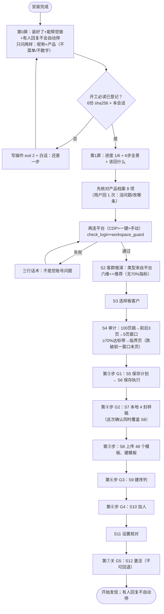

# AGENTS.md · 来发信 Skill 的 AI 执行入口（机器强制）

> 本文件给**任何 AI 工具**（Claude Code / Codex / ZCode / Cursor / DSH 等）自动读取。
> 它不替代任何文档，只负责把「先读什么、先登记什么、出错查哪里」说死。

## 🚀 开工顺序（少一步都不许开始找客户）

1. 先读这些文档（全部在仓库内）：
   - `SKILL.md`（入口路由）
   - `RULES.md`（唯一真源：确认闸门/安全边界）
   - `CORE-POINTS.md`（核心要点与实测数值）
   - `specs/beginner-flow.md`（新手 6 步全景）
   - `specs/novice-flow-contract.md`（回复次数与确认闸门契约）
   - `specs/problems-and-fixes-2026-10-23.md`（踩坑台账：已经踩过的坑）
   - `START-HERE.md`（用户/新手视角的一页上手）+ `docs/15-live-run-pitfalls.md`（真机实测踩坑速查）
   - `MD-METADATA.md`（Markdown 元数据规范：新增/修改文档前必读）
2. 安装自检：`python3 tools/onboard_check.py`（Windows 用 `py tools/onboard_check.py`；**未通过不得开始**）。这里的 `onboard_check` 是**安装门**；`preflight` 是维护者发布门，安装阶段不需要跑，失败也不等于安装失败。
3. 拿到用户第一条回复（昵称 + 产品）后，立即登记开工必读：
   `python3 tools/startup_gate.py ack --nickname <昵称> --product <产品>`（Windows 用 `py`）
   **已硬接线（机器强制）：唯一真实保存通道 + 执行卡校验 + 写票据铸造 + 16 个写脚本 CLI 入口（建模板/建序列/加人/激活/标签等）全部先过开工门；未登记直接 exit 2，并对用户说白话「还差一步：先告诉我昵称和产品」。** 测试进程用受控测试标记放行（只由测试框架设置，生产不可继承）。
4. 进入第 1 步：按 `specs/beginner-flow.md` 输出「6 步全景 + 当前第几步 + 该回什么」。

## 🗺️ 全流程地图（Mermaid 源码，AI 直接读）

> 逐模块逻辑、跳步规则、70% 适用边界、每步读哪份文档 → `specs/step-map.md`；下面只是总览。

## 🛡️ 铁律摘要

- 写操作五道确认闸门**逐个**确认，**不合并、不代答**；激活口令**必须含「确认激活」**。
- 用户视角只有 6 步；**S0-S12 编号/哈希/审批凭证等内部词不许对用户说**。
- **S2 候选只展示 4 类**：平台返回超过 4 类时，对用户只列评分最高的 4 类 + 一句「还有 N 类，回复『展开』再看」；禁止一次列 20 类。
- **Windows 下禁用 heredoc 跑 Python**：统一用 `py -3 <脚本>` 或 `py -3 -c "<一行>"`；禁止 `py - <<EOF` / `python3 - <<EOF`（zcode 等 Bash 工具的 stdin 不关闭会永久卡住）。改文件用 read/write/edit，不要用 heredoc 临时脚本。
- **S4 审计必须语义判断**：禁止用关键词/`--match-words` 给公司下结论；一律读平台返回的**中文公司描述**，直接判断「是不是本产品的潜在买家」。工具用 `--semantic` 只打印中文描述；保存阈值只算 AI 判定的真买家。
- 播报进度**每 10–30 秒一次**；用户不需要懂 Git/Python/token。
- **回答也受约束**：涉及规则/数字/话术前，先读对应文档并指出来源，不凭记忆作答（问答类无机器门，靠本纪律＋审查）。
- 出错先自查：`wiki/faq.md` → `specs/problems-and-fixes-2026-10-23.md` → `lessons/lessons-learned.md`；查不到再开 Issue，**禁止让用户自己排查**。

## 🔧 改规则

新增规则先改仓库文件（文档 + 测试），**跑 `bash tools/preflight.sh` 全绿后再生效**（一条命令 = 文档引用核验 + 全量测试 + 规则检查）。

新增或修改文档必须先读 `MD-METADATA.md`，按规范补 frontmatter 并更新所属 `INDEX.md`；`tests/test_doc_frontmatter.py` 与 `tests/test_doc_links.py` 全绿后才算完成。

本地提交/推送前钩子：clone 后跑一次 `bash tools/install_hooks.sh`，此后每次 `git commit` 与 `git push` 前都会自动跑 `tools/preflight.sh`，失败即阻止；应急跳过用 `SKIP_PREFLIGHT=1 git commit ...` / `SKIP_PREFLIGHT=1 git push ...`。
