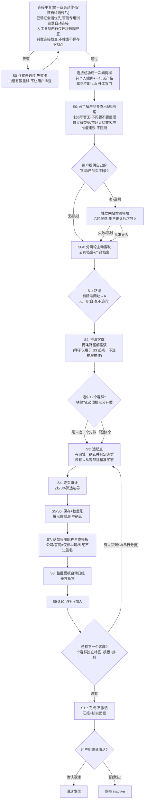

# 🧭 来发信 B2B 获客 · Skill 入口

> **一句话定位**：把"产品 → 推演客群/找种子 → 已选域名搜相似 → 连续 3 页（每页≥50%）窗口找 70% 边界 → 按确认计划保存前 N → 差异化模板（默认48）→ 12 步序列 → contact-add → 不激活待确认"整条外贸获客流水线，做成**判据明确 + 工具硬闸门 + 全程留痕**的可执行流程。
> **本文件只做路由与判据摘要**；执行任何步骤前先读 `RULES.md`（唯一真源）及指向的 specs，禁止凭记忆跳步。
> **★定位话术**：本系统=**批量获客/广撒网拿询盘**，不是精准开发——"广撒网铺量拿询盘；人或 AI 助手发现回复后须立即打‘询盘’标签，邮件序列才会停发；之后由您人工背调和精准跟进"。
> **★用户展示话术=照模板**（把用户当小白）：每环节给用户看什么/怎么说，照 `output-templates/S<节点>-*.md` 填充输出（人话+链接+具体核对点）；平台页面直达链接见下方路由表。
> **👶 第一次用/第一次接手**：先读 [START-HERE.md](START-HERE.md)（一页上手，人话）；**AI 排障直接用 [agent-pitfalls.json](agent-pitfalls.json)**（match→action→verify，人不用读）；需要解释再看 [docs/15-live-run-pitfalls.md](docs/15-live-run-pitfalls.md)。
> **断言分级纪律**：关键断言须标成色——实测✅/引用📚/推断⚠️/假设❓；写操作断言必须实测或小样实测+对账。

## 🚩 开工第一屏（必读，2026-10-23 用户要求）

> 执行到任意模块前，先看 `specs/module-api-map.md` 该模块行：入口脚本、真实 API、参数、门禁、要点、证据一次给全；文档与代码不一致以该表为准（差异清单 D1–D20）。
- **新用户第一业务动作先连平台**（安装自检通过后：复用已验证会话，否则 `tools/browser_login.py` 专用浏览器自动连接，人工复制仅环境故障兜底；连接成功前不问昵称/产品、不出档案，失败按 S0-连接未通过 白话重试）；**连接成功后一次问两样**（`output-templates/S0-opening-questions.md` C1：怎么称呼您 + 一句话产品），**不出菜单、不要数字**；拿到后立刻登记开工门并按 specs/beginner-flow.md 第 1 屏输出「6 步全景 + 当前第几步 + 接下来 + 等你回什么 + 约 10 次回话」，之后**每个阶段级汇报**都带三行（不是每句话）。
- 只有检测到旧项目才展示 `output-templates/S0-task-menu.md`「有旧项目时」4 项。
- 用户视角只有 6 步 + 最后发信开关；内部 S0-S12 编号不要对用户说（对照表见 beginner-flow 第八节）。
- 确认一律给编号（1/2/3，1=同意继续放第一）；两个例外：产品资料回「确认」、保存回「确认」或直接回卡上家数（卡面已写清 N 时，纯数字 N=卡面值；也可「确认保存 前 N 家」）；发信激活要求回「确认激活」四个字。
- 第 4 步写邮件前主动邀请：有以前效果好的开发信可以截图发我（1-5 张），只学结构/语气；产品事实仍取产品档案；提炼结果写 runs/运营方/产品/email-style.md。
- 踩坑台账：specs/problems-and-fixes-2026-10-23.md（每踩一坑先记账再改规则）。
- 🛡 **机器强制（开工门）**：拿到昵称+产品后立刻运行 `python3 tools/startup_gate.py ack --nickname <昵称> --product <产品>`（Windows 把 `python3` 换成 `py`）；未登记或必读文档变化时，**所有写操作（保存链 + 建模板/建序列/加人/激活/标签等 16 个写脚本）都会被机器拒绝**，并给用户白话提示；测试进程只由测试标记放行。

## 📖 回答纪律（每次答复前先看文档，不凭记忆）

> 适用于问答/解释/给建议，不限于写操作。机器门只能卡写操作；回答是否照文档，靠本节＋审查兜底。

1. **先定位**：这句话/这个数字属于哪一步？查本文件路由表与 `specs/module-api-map.md` 对应行，再打开对应话术卡或规则文件。
2. **再开口**：数字、阈值、口令、时长、模板结构，必须来自刚打开的文档，并能说出文件＋行号；不把「我记得」当依据。
3. **不清楚就查索引**：`INDEX.md` → `wiki/faq.md` → `specs/problems-and-fixes-2026-10-23.md`；查不到就说「未核实」，不编。
4. **用户可见话术只照话术卡**（`output-templates/`）；内部编号/GATE/哈希/审批凭据不得出现在答复里。
5. **报结论附证据**：跑过的命令、文件行号、测试结果；不凭印象报「已完成/已通过」。

- 🆘 **出错先自查**（不要一上来就问用户）：`wiki/faq.md` → `specs/problems-and-fixes-2026-10-23.md` → `lessons/lessons-learned.md`；查不到再按失败卡兜底并开 Issue，禁止让用户自己排查。

## 🗺 用户选择“开始新项目”后的渐进引导图（禁止安装后自动进入）




> 每步只问当前必需的一件事；用户永远可以用"确认/否/要改"推进。（图为节奏简化：S1 折入 S3 分支、S9a 为内部固定标签步骤、ERROR_BLOCKED 为全局异常兜底——完整状态以 §3 状态机表为准。）
> **三个必照模板的固化产出**：①登录检查通过 → 按 [S0-连接成功](output-templates/S0-connect-success.md) 展示账号状态卡（SVIP/配额/充值）②保存完成 → 按 [S6-数量账](output-templates/S6-count-report.md) 主动解释数量构成（未知邮箱默认已存；1.4~2.1 邮箱/家属正常）③**检查没通过/流程停下 → 按 [S0-连接未通过](output-templates/S0-connect-failed.md)**：先说"跟您有没有关系"、给**唯一**下一步、说明本次没动数据；**禁止把工具名/退出码/`[FAIL]`/`落点`等原文抛给用户**（2026-09-11 用户实测：小白看到"`gate_check.sh` 未通过"只会以为账号坏了）`bash tools/gate_check.sh` 末尾的「给用户看的这一段」已是白话，直接照抄。

## 1️⃣ 触发场景路由表（用户说什么 → 去哪）

开场由下列路由与 `output-templates/S0-opening-questions.md` / `S0-task-menu.md` 文案卡驱动；`tools/opening_gate.py` 是 ADVISORY/仅测试的契约参考，不参与生产判定。

| 用户说（触发词） | 路由到 |
|------------------|--------|
| "安装 / 第一次安装 / 学习这个 Skill / 帮我装好" | **只执行安装学习阶段**：下载或识别旧安装→保留 `.local/`/`runs/` 更新→自动准备环境→通读 README/SKILL/RULES/specs→运行 onboard 自检+扫描旧项目→**先按 `output-templates/S0-install-report.md` 用白话汇报**（装好没/能做什么/哪些要确认/有无旧项目；禁止抛 S0-S12、contact_add.py、status= 等术语，onboard 原始输出只给自己看）→**新用户先连平台**（复用已验证会话，否则专用浏览器自动连接；连接成功前不问昵称/产品、不展示菜单、不要求回数字）；**连接成功后按 `S0-opening-questions.md` C1 只问「昵称 + 产品」**；问完立刻给 6 步全景（`specs/beginner-flow.md` 第 1 屏）并直出产品档案。**只有检测到旧项目时**才展示 `S0-task-menu.md`「有旧项目时」的 4 项菜单（逐行+emoji+⭐推荐）。🔴安装阶段除昵称+产品外，禁止索取市场/卖给谁/官网/token，不得默认建新项目 |
| "新电脑第一次安装" / 环境缺 Python / `python` 找不到 | `specs/environment-setup.md` → `bootstrap.sh --install` 或 Windows `powershell -NoProfile -ExecutionPolicy Bypass -File tools/bootstrap.ps1 -Install` → check-only → onboard；完成后回到任务选择，不自动进入 S0。⚠️PowerShell脚本当前仅静态检查、未在全新Windows实机跑完；失败按SOP官方安装兜底 |
| 新会话（同机） / "接着上次" | `onboard_check.py` 枚举可续接项目并展示任务菜单；**开场按 `output-templates/S0-opening-questions.md` 分支**：无历史/读取失败→只问昵称+产品（禁止说"我记得您…"）；有历史→**复用 `S0-task-menu.md` 四项**（第 1 项填「继续「<产品别名>」（现在：<人话阶段>）」，不另造菜单），用户选继续或说"看看之前做到哪"后才展示产品别名+人话阶段（最多 3 个，超出说"还有 N 个更早的项目"）；再读 operation-record + product-profile 从当前节点继续；无项目也不自动建新项目，仍等待用户选择任务 |
| "换机 / 换电脑 / 另一台电脑接手" | README「💻 换电脑继续干」完整指令块 + `specs/migration-handoff.md`：旧机迁移 `.local/`+`runs/`+可选本地`db/` → 新机恢复同名路径 → token重新获取 → onboard枚举项目 → 禁止从S0重跑已有项目 |
| "更新到最新版 / 升级 / 老用户更新" | README「🔄 更新到新版本」办法 A：判断 git/ZIP → 备份 `.local/`+`runs/` → 更新原目录 → bootstrap check-only → 用输出的 `python_cmd` 跑 `onboard_check.py` → 汇报版本/变化/数据完好；冲突或旧文件残留先列出问用户，不强推不自删 |
| "帮我找 X 产品的客户" / 明确选择“开始新项目” | 用户已选择业务任务后才进入：S0 昵称+一句话产品 → S0a 建档/确认 → 登录检查 → gate → `flow_orchestrator.py --product <product_key> --product-info <用户产品说明> --profile <档案>`；`--product` 必须与 profile.product_key 逐字一致，不是中文展示名 |
| "平台没推出来 / 再试一次 / 推得不准 / 这几类买家不像" | 回 S2 客群闸门：按 `output-templates/S2-segment-confirm.md`「这次没推出来」块说话；质量不高可补推 **1 次**（最多 2 轮），补推前先说"我按…理解推的，这次结果不太贴，我再试一次"，记录轮次/来源/状态/条数/原因；补推后仍空 → 不进入客群选择，给三个出口（换说法 / 稍后重试 / 先换方向小批试） |
| "我有官网 / 这是我们网站 / 产品页 / 产品目录 / 帮我了解公司和产品 / 优化定位" | **可选独立模块** `specs/website-profile-sop.md` → **先按 D1-D4 四类分流**（自己的网址→六区候选+批准才入档；买家网址→只作 S3 起点；第三方参考→只作分析；归属不明→先问一句）→ `tools/website_profile.py` 校验/准备补丁/批准/正式档案单文件原子写入；失败或跳过不阻断 S0/S0a，不修改线上网站；两类网址同时给时各自独立处理 |
| "先了解完整流程 / 先看看怎么用 / 暂时不操作" | 只用通俗中文解释 README 的新项目流程图、产品适配、确认节点、默认不发信和询盘后人工跟进；**不索取产品/市场/官网/昵称/token，不执行 S0 或任何平台操作**；讲完停下等用户选择任务 |
| "我这产品适合跑吗 / 大宗 / 长周期 / 好几年才采购" | 只问卖什么（已有就不重复问），按 `specs/product-fit.md` 强/条件/弱三档做只读判断并如实说明预期；不要求昵称或 token，不自动启动新项目 |
| "这客户/这批准不准" / "临界在哪" | 状态机 S4 → `specs/threshold-method.md`（连续 3 页（每页≥50%）窗口 + AI 语义反思）+ `specs/threshold-probe-spec.md` v3.2（执行细则：连续3页（每页≥50%）滑窗/报告证据分离/四件套契约）+ `tools/audit_company.py`（⚠️仅趋势初筛，不得用 High 比例/单页/页1·2·5 当正式证据）|
| "怎么才存了这么点 / 邮箱太少 / 数量对不上" | S6 数量账：`output-templates/S6-count-report.md`——四机制（max3/验真/去重/异步提取）逐项解释；**未知邮箱默认已保存**；<1.0 邮箱/家建议查锚点 |
| "保存这批 / 前 N 条" | 状态机 S5/S6 → V2 保存链 `tools/save_company_cli.py prepare → confirm → execute`（`status/reconcile` 只读对账）；`confirm` 是唯一铸票点，`execute` 必须持同 binding 的 confirmed plan/render/ticket；旧 `save_first_n.py` 已加物理封条（`save_guard.require`，最早可执行位置），但仍非安全边界（可被删封条/伪造模块绕过）；列入禁用清单，禁止再用。无 confirmed plan 不写；用户回数字/选类型只是选类型，不是保存授权 |
| "写开发信 / 模板 / 预览" | 状态机 S7 → `tools/gen_templates.py --preview`；S8 生成后必跑 `tools/check_template_diff.py`（模板**自动归入同名分组**，禁散落"未指定目录"）|
| "建序列 / 跟进计划" | 主 AI 内部调用 `build_sequence.py --token <TOKEN_IN_MEMORY> --org <ORG_IN_MEMORY> ...`；内存占位不得让用户设置变量或执行命令。其余参数：序列名、tmap、profile、record、纯昵称、项目键、S9审批 |
| "加联系人 / 进序列" | 现役写通道 = `tools/contact_add_authorized.py`（开工门 + S10 审批 + `auth_guard` sequence 票据 + 时序守卫）；也可由用户自己在平台页面加，AI 只回读核对；旧 `contact_add.py` 仅作流程核对，已加物理封条（`save_guard.require`，最早可执行位置），但仍非安全边界（可被删封条/伪造模块绕过）；禁止直接 curl 写端点 |
| "激活 / 发信" | S12唯一凭证出口：项目必须已真实收口S11 → compliance-check `evidence_mode=live`且五项72h真实证据 → 用户在聊天里回「确认激活 <序列名>」→ 主AI用 `flow_orchestrator --resume-s12 --confirm "<用户原话>"` 只签绑定凭证（不联网/不激活）→ 主AI调用activate并真实回读active。普通flow末尾不得签S12；approval grant也禁止S12。★两条路：①用户聊天回「确认激活」→ AI 执行 ②**用户自己去** https://app.laifaxin.com/marketing/sequences 核对并手动开开关 → 回来告知 → AI 用 `activate_sequence.py --sync-manual` 只读核对 active 并同步本地（不写平台、不需审批凭证）|
| "验证这批对不对" | `tools/verify_exclude.py`（排除4区）/ `tools/verify_sequence.py`（12步）/ `tools/check_template_diff.py`（差异≥30%）|
| "模板重建 / 换模板" | `tools/rebuild_templates.py`（⚠️半自动，顺序铁律见 L-43，需人工分步）|
| "清空重来" | 危险操作，先用户确认。旧删库脚本（delete_all_products/contacts/tags/templates、purge_all_contacts）列入禁用清单：`delete_all_products` 已加物理封条（`save_guard.require`，最早可执行位置），但仍非安全边界（可被删封条/伪造模块绕过）；不得再调用；清空走平台页面人工操作，AI 只做只读核对 |
| "出问题了 / 记教训" | 本地问题登记（`db/issues.tsv`，本地数据不入 Git）+ `lessons/lessons-learned.md` |
| **"对抗审查 / 这个准不准 / 审一下"** | **RULES.md「🛡 操作对抗审查」（★用户强制：决策/产出必经空白子代理对抗）→ 按四类固定清单/执行前反思矩阵审 → 产出 `dialogue/reviews/rev-<日期>-<时分>-<操作>.md`（只放行/整改P0P1P2）→ 写操作三凭证：用户确认(approvals)+对抗审查(reviews)+操作流水(ops-log)** |
| "没有账号 / 怎么注册 / 值得跑吗 / 多少钱 / 399 / 15天SVIP / 没询盘怎么办 / 48小时几个询盘算合格 / 能不能绑自己的邮箱" | `docs/09`「算一笔账+验证裁决」：零成本先领 15 天 SVIP（联系客服）→ 399/年 SVIP 正式一波 → **48 小时有效询盘分层（2026-10-21 拍板）：≥3 = 好，扩大（询盘网址=新种子）；≥1 = 方向成立，继续加量；0 = 按下方「没询盘诊断口径」顺序判断；连续两轮 0 = 止损；退信问题只按下方「客户问退信怎么答」答复，不另设技术诊断**。问绑定邮箱 → 主动说明「绑自己邮箱容易被封号，平台也不支持绑定，不如多找客户」|
| "账号什么等级 / 配额多少 / 点数够不够 / SVIP" | 连接检查显示：账号等级、今日/本月配额；接口同时返回有效字段时再显示充值次数/自动充值 → 话术 [S0-连接成功](output-templates/S0-connect-success.md)。接口无余额/到期字段，禁止编造 |
| "查当前数据 / 最近跑批" | 本地运行记录（`db/runs.tsv`，本地数据不入 Git）+ 本地状态（`.local/`）|
| **"询盘来了 / 回复后不回 / 怎么背调 / WhatsApp / LinkedIn / 电话跟进"** | `docs/09-mass-outreach-to-precision-follow-up.md`：先打账号固定标签「询盘」停自动群发 → 公司/联系人背调 → A/B/C/D 分级 → 邮件为主；仅在已有明确许可并满足目标市场规则后使用 WhatsApp/商务社媒/电话；明确拒绝→「不发」停邮件，并人工登记全渠道停止。群发找信号，精准跟进做转化 |

### 🔔 客户问退信怎么答

仅在用户问到退信时，原样使用下面的短答；未问不主动展开技术细节。

> 20% 左右的退信按正常情况看；20%–30% 先查内容、暂不停发；超过 30% 先停发（只停后续）、再查内容。发信环境由平台统一负责，您只管更新内容、持续补充客户。

#### 🧩 发信通道与域名/IP 池（用户口径）

用户不需要自己配置域名、邮箱、SPF、IP；只更新内容并持续补充客户，不向用户展开技术排查。

来源与边界：上述阈值及平台描述来自用户 2026-10-21 提供的运营说明，属于用户口径，未经本仓一手平台资料独立验证，不作平台能力保证。禁止主动提 SPF/DKIM/DMARC、变量为空、绑定自有邮箱、换服务商、改行业；退信超过阈值也只看内容，不要求用户排查通道/域名/变量。

### 🔎 没询盘诊断口径

按固定顺序逐项判断：

1. 发信量是否 ≥3000/次：不足先加量，单次建议 3000+。先给增量上限与点数预算，用户确认后才执行；样本不足不作其它效果归因。
2. 客群精准度。
3. 询盘周期。
4. 成交周期。
5. 客群难度。
6. 开发信钩子（CTA）与吸引力。

单次 ≥3000 封且满 48 小时即视为量足，进入第 2 项；禁止连续两次以“加量”作为处置。名单邮箱数不足 3000（按历史均值约 1.5 邮箱/家，约 2000 家）时，同日发不到目标量：先说明样本限制并补充精准名单或等待，不为凑量放松精准度、不绕过发送上限。

**发信量不足时不展开其它效果诊断**，禁止把技术细节（通道/域名/变量）作为诊断首项。此顺序不覆盖已证实的客群错配、合规问题或退信异常：遇到已证实的问题先停止扩量、说明证据并处理，退信答复仍按上方口径；不得以加量绕过确认、预算或现有硬闸门。

★用户问「能不能绑自己的邮箱 / 配置域名邮箱」：主动说明「绑自己邮箱容易被封号，平台也不支持绑定，不如多找客户」。全库不向用户索要邮箱，也不做绑定可行性分析。

## 2️⃣ 新获客项目的必备前置（用户明确选择后才执行，缺一停）

- **★用户没有来发信账号时先引导注册（2026-09-09 对抗审查补）**：让用户去 https://laifa.xin 点页面上的「免费注册」（注册免费、无需先付费），注册登录后再走连接检查。AI **不代办注册、不代填手机号/邮箱、不承诺权益数额**；权益/套餐/赠点一律以官网客服实时答复为准
- **★首次调用平台前必过=登录检查**（不是安装或对话开局第一句）：到此节点仍无凭据/已失效，按 [T-token引导](output-templates/T-token-guide.md) 的**三层降级**执行：①CDP 自动（首选）——在 `https://web.laifaxin.com` 通过现有 Chrome/Edge 自动取参；②一键命令兜底——自动失败且适用时，请在 **app.laifaxin.com** 页面执行下方命令，粘贴回车后通过剪贴板回传；③手动两值兜底——仅对 11/14/20/21/26 的 `E_BROWSER_UNSUPPORTED`，命令被拦时才引导用户在 `https://app.laifaxin.com` 按三步复制两个值。13/15/12/23 只给“确认目标空间/重新登录”类指引，不引导手动取参。**禁止让用户手写文件或手敲/背诵 token；只允许剪贴板粘贴与 `session_store`（目录 0700、文件 0600）；AI 不回显 token、不写 runs 日志。跨域 token 有效性为 UNVERIFIED，待首次真实平台冒烟验证；每次取参后强制运行 `workspace_guard` 做落点校验，通过前停止。**
  - 一键兜底命令（请在 **app.laifaxin.com** 页面执行；原样给出，不拆行）：
    ````
    var t=localStorage.getItem("accesstoken");t&&t!=="null"?(copy("accesstoken="+t+"\norgId="+localStorage.getItem("orgId")),"✅ 已复制到剪贴板！回到对话框 Ctrl+V（Mac按⌘V）粘贴发送给 AI"):(location.host.indexOf("laifaxin")<0&&location.host.indexOf("worldtradetool")<0?"❌ 你现在打开的网页（"+location.host+"）不是来发信——请在 app.laifaxin.com 页面执行本命令":"❌ 来发信页面上没取到登录凭证——先看右上角有没有你的账号头像：没有=先登录；有=按 F5 刷新后再运行一次");
    ````
  - 手动兜底：只让用户分别复制 `accesstoken` 与 `orgId`，说明企业账号二者不同、漏 orgId 会连错空间；不要手敲。
  - 生产连接主体是真实 Chrome/Edge 的 CDP；Playwright 仅作可选能力探测，不作为生产依赖。探测要同时检查 Python 包与浏览器二进制；离线不要求安装。
  - **主 AI** 不回显、不写日志、不传子代理；用户明示授权后，仅允许本机 `session_store` 保存会话凭证（**目录 0700、文件 0600**、用 `--forget` 清除、备份与迁移必须排除）。该文件不是安全边界，真正防线是远端校验：每进程首次复用须通过 `check_login` 与 `workspace_guard --require-verified`。
  - 🔴 **orgId=工作空间ID，与 token 中段（用户ID）是两回事**：个人账号二者只是恰好相同；企业账号 orgId 是独立值，必须从 localStorage 一键双取。缺 orgId 时所有账号一律停止，禁止回退 token 中段或默认个人空间
  - 🔴 **拿到凭据后必须做"落点校验"，不能只看接口成功**：`?uid=` 只是请求参数，token 对该 org 无权限时平台会**静默落回 token 自己的空间**且仍返回成功——所以"接口成功 + 参数回显一致"证明不了空间对。登录检查后立刻跑 `python3 tools/workspace_guard.py --credentials-stdin --require-verified`（`gate_check.sh` 的 `[2b]` 也会跑）；命中"声明企业却判个人"或"判企业却 orgId==用户UID"必须停止，让用户切到目标空间重新一键双取。汇报只能说"落点校验通过"或"未校验"，禁止用参数一致冒充空间正确。
  - 安全边界：token 等同登录凭证，只发给你信任的 AI（本流程仅用于你会话；仅可按上述例外保存本机会话凭证）；不要发群聊/工单/公开文档
  - 首次连接只做只读检查（不搜客/不保存/不扣点/不发信）；换账号/切 org 需重新获取两样
  - 🔴 **token 单点有效**：用户在其他设备/浏览器登录、或网页重新登录 → 旧 token 立即作废——"token已失效"时引导在窗口里登录一次后再重取，同一份反复重试无意义（check_login 会计数升级提示）
  - ℹ️ token 开头域名可能是 web.laifaxin.com 或 web.worldtradetool.com 等——均正常，勿按域名判真伪
- **★最小必要输入（2026-09-07 对抗收口：渐进索取，禁止开局列清单）**：
  - **对话开局只问 1 类**：**纯个人昵称 + 一句话产品**（如“Tony；我卖不锈钢保温杯”）。卖给谁、卖到哪、自己的官网/产品页/目录全部选填；没给时 AI 只给非客群的准备性建议（如先准备资料、先判断适配），不生成/选择具体买家类型，不阻断、不重复追问、不冒充用户输入。
  - **首次调用来发信平台前再问第 2 类**：首选 CDP 自动取参；自动失败再用完整一键命令复制 `accesstoken=` + `orgId=` 两行，直接粘贴到当前聊天框；命令被拦才分别复制两个值。AI 经 stdin 做只读检查；缺任一字段必须停止，不回退、不要求用户拆参数
  - **★昵称规范（2026-09-09 模拟补强）**：只含一个纯个人称呼。英文名与中文名混合一律拒绝；中文昵称须为2-4个纯汉字，带连字符或厂/包装/食品/机械等公司产品词拒绝。Tony / Jean-Pierre / 老王 / 张伟 / 欧阳娜娜可用；`Tony-包装厂`、`王-包装厂`、`张伟食品包装`不可用。公司资料只入本地档案，不进入邮件签名。
  - **后续节点用到现在才要**：S0 **不再产出 A/B/C/D 买家类型清单**，只给「往哪个方向找」的参考（离产品近/买得多/会回邮件，非必答、不用回字母）；平台没返回时不得用参考兜底；具体买家类型只在 S2 由平台返回、用户选编号（两步分工，不重复问）；S3 优先引导用户给起点网址（询盘客户/认得的精准买家）；没有则从平台返回的客群挑精准买家，不重复追问；S7 邮件签名只用昵称——公司/官网（用户自己的商业资产）AI 主动要 **仅供 AI 建档/背调**，绝不写进邮件签名；邮箱不索取（平台不支持绑定自有邮箱）。
  - **★产品资料=获客必需素材，用户不给AI也主动要**：公司级资料按 `operator-profile-sop.md` 回落 `.local/operators/<operator_key>.md`；产品级资料按 `product-profile-sop.md` 回落 `runs/<operator_key>/<product_key>/product-profile.md`。每次单独问一组，给填空模板、可跳过、不逼问。★**邮件边界**：邮件末尾签名区永远只有纯个人昵称；
    公司名/官网不进入签名；邮箱不索取（平台不支持绑定自有邮箱）；经用户确认且有字段级来源的认证/产能/MOQ/交期可用于正文卖点（**价格/折扣不写入**）；推断或无来源的具体事实禁止写入。★潜在买家/客户/联系人第三方联系方式不索要、不写入上述档案。S2/S4/S7/S9 必须绑定当前 profile path/version/hash；零上下文续接先读两类档案。
  - **公司级/产品级资料都可主动要**（每次单独问一组，给模板可跳过）：公司名/官网/默认市场→operator-profile（不索取邮箱）；产品线/认证/产能/MOQ/交期/价格带→product-profile。签名区只含昵称；confirmed 且有来源的产品事实可进正文卖点；没有事实时只用无具体承诺的通用表达。
  - 每次**只问当前节点必需的一件事**，给默认建议，用户回复"确认/否/要改"即可推进。
- **★职责边界（v3 硬约束，不得违背）**：本地 AI 可做产品了解、适配判断、用途假设、解释与排序建议；**禁止产出/命名/选择具体客群，禁止把本地建议映射成客群，禁止在平台未返回时给 S3+ 提供客群依赖输入**。S2 客群只能逐条来自本次平台返回，必须记录来源接口、调用成功状态、返回条数；不本地补条、不凑数。平台返回失败/异常/空/只有旧客群 → 不推进客群状态、不执行依赖客群的 S3+ 动作，只给一句可重试人话（照 `output-templates/S2-segment-confirm.md`「这次没推出来」块）。
- **闸门硬条件**：主 AI 将聊天框收到的两行整段通过程序化 stdin 交给 `bash tools/gate_check.sh --credentials-stdin --product <项目键>`（★bash 脚本，勿用 python3 调用）；全部通过只表示登录/权限/工作空间预检通过，**不等于规则理解、审计收口或保存计划获批**；V2 保存还需 confirmed plan/render/ticket。未通过禁止任何保存/模板/序列/contact-add。旧 `--token/--org` 只作 AI 内部兼容，不得向用户展示
- 缺开局的昵称/产品 → **只问缺项，不猜不代填**；到首次平台调用仍缺 token/orgId → 再引导一键双取并停在连接闸门。
- 原始凭据只允许由当前受信任主 AI 临时处理；仓库工具**禁止文件、`.env`、持久环境变量、工具日志、完整回显和子代理扩散**（失效计数仅存短哈希/次数）。聊天服务是否保存对话取决于宿主隐私政策。后续仍需纯 token/org 参数的内部工具，由主 AI 在内存中解析并调用；不得把拆分工作交给用户，也不得误把两行整段传给只接受纯值的工具。
- 本地运营方档案（`.local/operators/<operator_key>.md`，旧单文件兼容）：昵称为必需；公司名/官网/邮箱可主动要、跨产品/换机复用；签名区只昵称，客户第三方资料不写入。

## 3️⃣ 状态机 S0-S12（每节点一句话判据，细节见 RULES.md）

| 节点 | 一句话判据 |
|------|-----------|
| S0 INPUT_GATE | **必填只有昵称+一句话产品**（中英皆可）；卖给谁/卖到哪/自己的网址均选填。开工先连平台（复用已验证会话/专用浏览器），连接成功后按 `S0-opening-questions.md`：无历史一次问两样；有历史**复用 `S0-task-menu.md` 四项**（不另造菜单），用户选继续或说"看看之前做到哪"后才给产品别名+人话阶段（≤3 个，超出说"还有 N 个更早的项目"）。缺买家类型或市场时只给**非客群的准备性建议**（不生成/选择具体买家类型），不阻断、不冒充用户输入；方向参考不落档、不当买家类型用（用户不用回字母）。用户给自己的官网/目录/产品页 → 只走独立 `website-profile-sop.md` 六区候选，批准补丁后才导入；买家网址只作 S3 起点，第三方参考页只作分析，归属不明先问一句（D1-D4 分流）；模块失败/跳过继续原流程。用户给卖点文字/文件 → 按用户来源提炼；没给 → 邀请补充一次、可跳过。★**用途卡之前**按 `output-templates/S0-fit-notes.md` 给只读判断（强/条件/弱，对用户说"这产品适不适合这样群发找客户"，不要求回复）；弱适配如实说明预期，由用户决定 |
| S0a PROFILE_PENDING | 分两轮主动索取：①公司级资料→`.local/operators/<operator_key>.md`（多公司隔离/跨产品/换机复用）②产品级资料→`runs/<operator_key>/<product_key>/product-profile.md`。每轮一组、可跳过不逼问；产品档案必须 confirmed 或 declined 才能进 S1，draft 阻断；后续绑定版本/hash |
| S1 PATH_PENDING | **此前连接已验证并复用有效会话**（连接在安装自检后第一动作完成）：本节点**不再次连平台、不重复问昵称/产品**，档案确认后只问一句：「您手上有熟悉或问过价的买家网址吗？有就发我；没有也行，我先帮您找买家类型。」有网址→快速路径 A；无→标准路径 B **自动选择，不追问**（用户随时可补网址切换） |
| S2 SEGMENT_PENDING | **两条路径都推演**；★**客群只能逐条来自本次平台返回**，记录来源接口/调用成功状态/返回条数；success=false、异常超时、成功但列表空、只拿到旧客群 → **不推进客群状态、不执行依赖客群的 S3+ 动作、不本地补条**，给一句"平台这次没推出来，我稍后重试，或您稍等再点一次"。★质量补推：空/与已否定或已选重复/明显跑偏 → 可主动再推一轮（最多 2 轮），补推前先说"我按…理解推的，这次结果不太贴，我再试一次"，补推不改用户已确认的用途；仍差则给三个出口。★**多客群分批**（铁律7d）：选中≥2个必须提示分开做并告知 K×48 模板+K 序列（默认48=12轮×4），一个客群走完 S3→S10 再做下一个；推演 4 客群，逐个判"会不会采购"+周期/询盘/量级/邮箱/竞争度，给推荐，用户确认（★档案=**推理档案** inference-product-add；推演描述用 `tools/product_desc.py` 固定四段+档案①-③白名单（④目标客群不参与，只留本地备注），用途不写档案；★展示条数=本次返回条数，历史遗留不混入；★用途与推演来源写 operation-record 可复现；★客群推演**优先读 product-profile.md** 的产品线/客群/卖点，推得更准）|
| S3 SEED_PENDING | ★入口二选一：有起点网址→确认并判定其客群；没有→从已推演客群挑精准买家。**起点必须关联客群**。AI 数据库搜索链三步：①当前轮 query_en **逐字**搜第一页（25字段/条，含 id、无 domain；同一 generation/segment）②代表买家 id→`domain/base-info` 取域名并落选择记录 ③**已选域名**作 keyword 走主搜扩量（禁 similar-list）→用户确认锚点；随后 S4 审计（同一域名/来源范围）、S5/S6 按 S4 的同一 keyword/filters/logic/sort 保存，不另换词 |
| S4 AUDIT_RUNNING | 只读+AI 语义反思找 70% 边界：100页跳→前后3页→**连续3页（每页≥50%）滑动窗口**→逐页；单页只记抖点，High比例/搜索分数/页1/2/5抽样不是窗口证据。按三条客户线留痕。正式收口须 `evidence_mode=live` 并绑定真实线上审计+独立review hash；模拟/离线/网络桩/占位只能出演练报告，禁止推进S4或保存 |
| S5 SAVE_PENDING | 展示 confirmed plan：N（家）/E（邮箱）/P（点）/B（预算）及来源、连续窗口边界、四区 filters、标签实际ID、max_points 来源/版本、重复保存检查；用户原话确认后才保存（→confirmed plan/render/ticket）。`prepare` 不出写、`execute` 才写；无 plan 不写；不擅自缩量；用户明确20家且计划成立则允许。**保存前自动校准**：`tools/save_budget.py probe` 只读余额 → `begin` 执行前确认 → `settle` 取样（finished 后稳定读数，仅 preliminary）→ `carry` 结转（late 加回；执行前+结转后两次确认才 confirmed）→ `plan` 用冻结预算算 [N_cons,N_est] 区间；无历史先 **100 家一次探针**（单独确认；拿到单价/联系人率后直接按预算推导 N 全量，不再 1/10/50 逐档）；未结清批次按批窗口计入预算并冻结；平台不返回点数消耗，禁止臆造系数 |
| S6 SAVE_RUNNING | front 保存；等任务 status:finished；用 `status` 按本 plan/attempt/task_id 只读回读，`reconcile` 只消费本 CLI 生产记录；用标签结果/contactSaveCount 对账。★完成后主动出示**数量账**（S6-count-report.md：max3/验真/去重/异步四机制；历史 1.4~2.1 邮箱/家属正常，<1.0 查锚点）。结果不明保留锁，不盲目重试 |
| S7 TEMPLATE_PENDING | 只生草稿，展示默认 4 个、用户主动要多看最多 8 个**渲染后视图**+理由，确认后才批量创建。★邮件末尾签名区只有纯个人昵称，禁止公司名/官网/邮箱/职位/认证/宣传语。★正文卖点只可使用当前 confirmed product-profile 中有字段级来源的事实（认证/产能/MOQ/交期等；价格/折扣禁止写入），计划绑定 profile hash 并逐句 claims 校验；declined 档案只用无具体事实通用表达。生成模板前按 P1 留存模板读取回执，详见 [specs/sequence-config.md](specs/sequence-config.md) |
| S8 TEMPLATE_BUILD | 生成整批模板（默认48=12轮×4）并**自动归入同名分组**（禁散落未指定目录），断言变量样式/标题/差异（Jaccard≤0.70），失败回 S7 |
| S9 SEQUENCE_PENDING | 12 步(30分/5/15/30天)+纽约时区+每日30000(全账号)/每公司每日5+notSentTags，确认后建。★客群成交/询盘周期以季~年计时（条件/弱适配），如实告知节奏为快周期设计，建议先不激活（不发不花钱）、等有需求再开，或改人工低频培育；轮数固定 12，不承诺改轮次 |
| S9a FIXED_TAGS（S9内部子检查，不单独推进operation status） | 账号固定标签“询盘/不发”：build_sequence前先查同名，存在复用id，不存在才经绑定审批创建；notSentTags解析失败则S9 fail-closed |
| S10 CONTACT_PENDING | finished+标签联系人>0+序列 inactive+对账+确认后 contact-add(views:[]) ；★现役写通道 `contact_add_authorized.py`（S10 审批 + auth_guard sequence 票据 + 时序守卫）；平台页面人工加也可，AI 只回读；旧 contact_add.py 仅流程核对。不得宣称「无 CLI 通道」 |
| S11 READY_INACTIVE | 仅 `evidence_mode=live` 的 verification-manifest + 4份真实线上验证证据可正式收口；模拟/离线/网络桩/占位不得说“流程完成”或推进S11。正式收口后输出完整流程与参数，保持inactive，展示用户核实面板六条 |
| S12 ACTIVE | compliance-check须 `evidence_mode=live` 且五项为72小时内真实证据；模拟/离线/桩/占位拒签凭证和激活。S11项目用 `flow_orchestrator --resume-s12 --confirm "<用户原话>"` 只签绑定凭证（用户聊天里确认即可，不联网、不激活），再由activate本地全闸通过后首次联网并回读active |
| ERROR_BLOCKED | 异常/参数变/对账不一致 → 只读检查，禁写 |


## 🔗 平台页面直达（给用户的核实链接，2026-09-03 用户拍板：让用户自己看）
登录 app.laifaxin.com 后，告诉用户直接打开：
| 看什么 | 页面 | 链接 |
|---|---|---|
| 邮件模板（整批，默认 48 个）| 设置 → 邮件模板 | https://app.laifaxin.com/settings/templets |
| 序列（12 步计划/inactive 状态）| 智能跟进 | https://app.laifaxin.com/marketing/sequences |
| 保存的客户任务 | 搜客引擎 → 客户保存记录 | https://app.laifaxin.com/search/saved-tasks |
| 发信设置 | 邮件营销 | https://app.laifaxin.com/marketing/tasks |
| 时区计划 | 计划时间 | https://app.laifaxin.com/settings/sequence |
| 联系人/标签 | 登录后左侧菜单「联系人」 | （按菜单进，搜标签名即得）|
> 给用户的话术模板："您打开 <链接>，找 <名称>，核对 <什么>"——每项核实点写具体。

## 4️⃣ 铁律摘要（0-8，违反即错，详见 RULES.md）

0. **排除中国 4 区** CN/TW/HK/MO——保存与 S4 扩量搜排除；S3 文本搜不排除（schema：`values:[]` + `value:""` + `valueType:"select"`）
1. 保存 `selectOption:"front"`（≠current，current 邮箱 0）+ `contactMaxCount:3`（不足才 3→6→9 升阶）
2. 模板变量 `<code class="lfxFieldVeriable" contenteditable="false">{联系人:名称}</code>`；标题纯文案；差异≥30%（实测 Jaccard≤0.70）
3. 不翻页收集 id（封号）——保存前 N 用 `selectTotal=确认计划的正整数`（单位家；`selectKeys:[]`、`selectSort:{}`、`selectOption:"front"`）
4. 验证用 `backend-task-status`（contactSaveCount）；删除进度用 `backend-progress`
5. 发信前去重；每日全账号上限 30000、同一家公司每日 5；notSentTags=[询盘,不发]。平台负责发送技术基础设施；激活前 AI 逐项自查市场/名单/主体/退订/拒收并展示结果，用户只做最终确认。
6. **时序**：等保存 `status:finished` + 标签联系人>0 后才 contact-add
7. **标签=客户群体身份 `语言-行业-角色`**（不是你的产品）；记录一律 `id(名称)` 成对
7a. **署名=纯个人昵称**（禁公司名/产品名/职位入昵称与落款）；公司/官网/邮箱可主动要但**仅供 AI 建档**，绝不进邮件签名
7b. **保存邮箱口径=valid+unkown 都存**（未知邮箱默认保存）；数量落差四机制主动向用户解释（S6-数量账）
7c. **语言三方配对**：标签/模板/序列语言一致才 contact-add（西语客群禁收英语信）——contact_add_authorized.py 内置守卫
8. 内部命名（标签/视图/序列/模板分组）一律中文；邮件正文=目标市场语言（默认全球英语）

## 5️⃣ 新会话 / 换机三步走

1. **环境先就绪**：无 Python 先按 `specs/environment-setup.md` 跑 `bootstrap.sh/bootstrap.ps1`；环境全绿后运行 `python3|py tools/onboard_check.py`，让它枚举可续接项目。
2. **先判分支**：有项目 → 报告项目和人话节点，仅展示 `S0-task-menu.md`「有旧项目时」4 项，用户选“继续以前的项目”后才读 `operation-record.md` + `product-profile.md` + `reflection/evidence/verify-*` 从当前节点继续，禁止从 S0 重跑；没有项目 → 先连平台（复用已验证会话，否则专用浏览器自动连接），连接成功后按 `S0-opening-questions.md` C1 只问「昵称 + 产品」，不展示菜单，拿到后直接进入第 1 步并直出档案。
3. **换机先恢复本地状态**：按 `specs/migration-handoff.md` 从旧机迁移 `.local/`、`runs/<operator_key>/` 与可选本地 `db/`；token 在新机重新获取；历史 approvals 只作审计，未执行写节点与 S12 必须当前对话重新确认。

## 6️⃣ 关键文件地图

| 类别 | 文件 |
|------|------|
| 规则（唯一真源） | `RULES.md` → `specs/environment-setup.md`（零Python依赖准备）/ `specs/migration-handoff.md`（换机续接）/ `specs/operator-profile-sop.md`（公司级资料主动索取/跨产品复用）/ `specs/product-profile-sop.md`（产品资料提炼/确认/版本/hash/复用）/ `specs/website-profile-sop.md`（独立可选网站增强）/ `specs/product-fit.md`（适配三档）/ `specs/threshold-method.md`（连续3页（每页≥50%）窗口/语义复核）/ `specs/domain-scale-sop.md`（query_en→已选域名→同审计范围保存）/ `specs/sequence-config.md`（模板+序列） |
| 流程逻辑 | `methodology/decision-trees.md`（A/B 路径图）/ `INDEX.md`（导航）/ `MD-METADATA.md`（文档元数据规范）|
| 环境/迁移 SOP | `specs/environment-setup.md`（零 Python bootstrap）/ `specs/migration-handoff.md`（换机备份/恢复/续节点） |
| 当前状态 | `runs/<operator_key>/<product_key>/operation-record.md`（流程节点）+ 同目录 `product-profile.md`（资料状态/版本/hash）；`.local/` 只存运营方档案与审批流水，不是当前节点真源 |
| 工具（工具=规则） | `tools/bootstrap.sh`/`bootstrap.ps1`（无Python环境准备）、`onboard_check.py`（环境复查+可续接项目扫描）、`product_profile.py`/`profile_utils.py`（S0a档案状态/版本/hash+纯昵称/第三方信息闸门）、`gate_check.sh`（预检，不是规则读懂证明）、`check_login.py`（登录+账号状态卡）、`flow_orchestrator.py`、`approval.py`、`seed_resolve.py`（S3 id→域名）、`tag_add.py`（S5 前置建标签，同名复用）、`segment_registry.py`（当前产品/轮次来源记录）、`search_company.py`（S3/S4 两种只读搜索）、`save_company_cli.py`（V2 保存计划链 prepare/confirm/execute/status/reconcile）、`save_plan.py`/`rule_check.py`（计划/真实数量/预算校验）、`api_base_url.py`（生产固定基址，仅测试 context 注入 loopback）、`auth_guard.py`/`render_guard.py`/`save_guard.py`（票据/留痕/count绑定/写授权）、`gen_templates.py`（profile+claims+签名硬闸门，自动归组；须 `--auth-ticket`）、`check_template_diff.py`、`build_sequence.py`（须 `--auth-ticket`）、`activate_sequence.py`（须 `--auth-ticket`）、`resolve_schedule.py`、`verify_exclude.py`、`verify_sequence.py`、`rebuild_templates.py`、`audit_company.py`、`render_preview.py`、`check_rules.sh` |
| 用户话术模板 | `output-templates/`（README=总索引；T-token/S0连接+画像/S0a运营方档案+网站资料确认+产品知识档案/S2/S3/S4审计中/S5/S6数量账/S7/S8构建中/S9/S10/S11/S12/Q1-Q5 18 个话术模板+1 个总索引）|
| 档案（多公司多产品） | `runs/<运营方>/<产品>/`（operation-record/reflection/evidence/**product-profile**/verify-*）+ `runs/_template/` + 本地运行记录（不入 Git）|
| 问题与教训 | 本地问题登记（`db/issues.tsv`，本地数据不入 Git，open 即待办）/ `lessons/lessons-learned.md`（L-01~L-61；L-44 起为脱敏抽象条目，随库分发）/ `review-cycle.md`（旁观者审查）|

> ⚠️ **执行纪律**：写操作必须带 `--approval <id> --project <operator_key>/<product_key>`；凭证仅 `confirm+confirmed` 可用，并须与工具按实际参数重算的hash一致。modify/pending/backfilled不可授权。S5 另须 confirmed plan/render/ticket 同 binding；菜单/列表数字不等于授权，但保存卡写清家数/邮箱数/额度消耗后，用户回复「确认」、直接回卡上家数（纯数字 N=卡面值）或含家数的原话（如「确认保存 前 2600 家」）都是保存授权；confirm 必须携带 present 产出的卡引用（同计划/同 revision/未过期/卡 hash 一致）；卡面数字必须与 plan 一致，纯确认与纯数字都会绑定卡面 N 并留痕 count_bound_by=card，数字≠卡面值须重新 prepare 重发新卡。
>
> ⚠️ **写入口纪律（2026-10-21 V2）**：旧 8 个写脚本 + 5 个删库脚本为禁用清单（**除 P6 四个抓包脚本外，`save_first_n`/`contact_add`/`delete_all_products`/`wait_save_done` 也已加物理封条（`save_guard.require`，最早可执行位置）；但仍非安全边界（可被删封条/伪造模块绕过）**，见 RULES 边界声明），禁止再调用；保存只走 `save_company_cli.py` 的 prepare/confirm/execute 计划链，无 confirmed plan 不写；**实际票据分层**：S5 保存=save_guard V2 plan/render/ticket，S10 加人=auth_guard `authorize_write(action="sequence")`，模板/序列/激活=approval.py 审批凭证（S12 另加原话校验），**不是** authorize_write。保存成功按 S6 数量账与 `status/reconcile` 对账汇报；旧 `report_text` 校验约定保留为历史，新链路若返回 render 绑定则按其校验，禁止手写 sha。
>
> 📌 **V2 保存用法（参数以 `python3 tools/save_company_cli.py --help` 为准）**：
> ```bash
> python3 tools/save_company_cli.py prepare --request-file <offline-input.json> [--root <仓库根>] [--out <draft.json>] [--run <执行卡运行标识>]
> # 也可用 --request-json '<JSON文本>' 代替 --request-file（二者只能二选一）
> python3 tools/save_company_cli.py confirm --plan <draft.json> --quote "<用户原话>" --quote-ref <来源>
> python3 tools/save_company_cli.py execute --plan <confirmed.json> --render <S5V2 render> --ticket-file <ticket.json> [--token <T> --org <orgId>]
> # 也可用 --ticket-json '<JSON文本>' 代替 --ticket-file（二者只能二选一）
> python3 tools/save_company_cli.py status --plan <confirmed.json>
> python3 tools/save_company_cli.py reconcile --plan <confirmed.json> [--task-id <id>] [--task-status-json <file>]
> ```
> `prepare` 只读本地、不取凭据/不构造写 transport；offline-input 最小 JSON schema 与样例见 `specs/save-offline-input.md`。`confirm` 绑定 plan/render/ticket；`execute` 先做工作空间预检、重验同一 binding 后才写；`status/reconcile` 只读对账。旧无子命令执行形式只能作 execute 别名且仍须 confirmed plan。工具算出的 hash 只证明文件/参数摘要，不证明模型读过、理解或真人授权；本地记录不防同机恶意改写。
> 🆘 新手黑话/常见疑惑：`glossary/glossary.md`（系统词人话表）· `wiki/faq.md`（配额/接口空/数量落差/None 等FAQ）· 渐进索取/昵称/署名/账号状态卡规则见上方 §2 与 output-templates/
> ⚠️ **审批闸门边界（防呆不防恶）**：`--approval` 校验的是本地 `.local/approvals.tsv`（每账号/每 clone 一份，不入 Git），该文件对本机 AI 可写——**自证行 ≠ 用户授权**。高风险操作（保存/建序列/加联系人/激活）仍必须在对话中出示用户原话；AI 自行 append 的凭证视为无效（审批补记·内部教训）。
> 🔑 **凭证出口**：① `flow_orchestrator.py` 在节点实际参数齐全时签发绑定 hash 的 confirm/confirmed 凭证；② 参数尚未齐时只记 pending，待执行前用 `approval.py grant --params-file <实际参数JSON>` + 当前对话用户确认原话签发。modify/pending/backfilled 不构成写授权。
