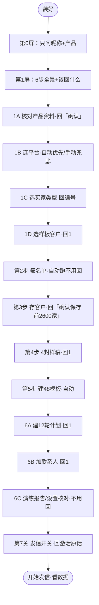

# 新手全流程模拟演示（从装好到第一封发出，逐环节含逻辑）

> **用途**：内部排练/培训稿。不要整份发给老板；给老板看时只摘每屏「用户看到」。
> **话术真源**：`output-templates/` 与 `specs/novice-flow-contract.md`。本稿是节选与演示，有出入以真源为准。
> **演示设定**：老板 Tony、产品不锈钢保温杯、主卖美国；全新电脑已装好、自检通过；平台已注册、域名/邮箱由平台验证。
> **演示值（可改）**：公司/邮箱/点数/各屏耗时/送达率等示例数字——计划存 2600 家、实存 2480 家、3210 个邮箱、约 3300 点、约 2 分钟等。
> **固定口径（不是演示值，不许当虚构改掉）**：12 轮跟进、48 个模板、每人每轮只发 1 封、默认 4 封最多 8 封样稿、账号每天最多 30000 封、同一家公司每天最多 5 封、每公司本批最多存 3 个邮箱（可调 3/6/9，越多越耗点）、退信 20%–30% 先查内容暂不停发、>30% 先停发、连续两轮 0 个询盘才止损、自动环节每 10–30 秒播报。
> **卡首行纪律**：每个阶段卡必须有「进度：第 N 步 / 共 6 步」「现在：」「该回什么：」；自动环节再加「预计 X 分钟 / 还要约 X 分钟」。下面每屏的「卡首行」就是示范。
> **口播禁令**：不念内部词（序列 id、审批凭证、哈希、状态机等）；不念尖括号占位符；不承诺效果；不把「平台负责发信环境」说成「发不到有人兜底」。

## 一、整条路



**顺利时约回 10 次；账号能自动连上时少一次（约 9 次）；中途改资料、重连、口令重试会多 1–2 次。**

**总规则**：要花钱（第 3 步）和要真发信（第 7 关）只认含家数/计划名的原话；其他步骤回编号/「确认」即可。

| 序 | 什么时候 | 老板回什么 | 为什么必须是他回 |
|---|---|---|---|
| 1 | 第 0 屏 | 昵称 + 产品（一条消息） | 只有他知道 |
| 2 | 产品资料 | 「确认」或说改哪条 | 事实来源要他认 |
| 3 | 连平台 | 自动连上就不用回；不行才粘两行 | 授权只能他给 |
| 4 | 选买家类型 | 编号（如 1） | 选错全错，必须他定 |
| 5 | 选样板 | 1 / 2 / 网址 | 他认得的买家最准 |
| 6 | 存客户 | 「确认保存 前 2600 家」 | 花额度，必须亲口 |
| 7 | 样稿 | 1 / 2 | 话术他要认可 |
| 8 | 建计划 | 1 | 节奏他要点头 |
| 9 | 加人 | 1 | 加人等于确定发给谁 |
| 10 | 发信开关 | 方式一「确认激活 英语-保温杯-批发商-S04」或方式二「我已在网页激活 英语-保温杯-批发商-S04」 | 不可逆，必须他亲口 |

---

## 二、逐环节

### 环节 0｜装好的第一屏（约 2 分钟）

**卡首行**：0 屏可不带「第几步」，只报装好 + 问两样。

**用户看到**（节选，三件事都要说到）：
```text
✅ 我这边已经装好了、检查通过。装的时候不用您动手；连接账号、开发信开关这两步要您点一下，我会一步步带。
第一次发信前我会先问您：您不说「确认激活」，一封都不会发。
存客户前我会先说要扣多少平台额度，您同意再存。
有人回复不会自动停——您看到回复告诉我，我马上给这个人打「询盘」标记；
标记生效后就不再自动给他发（平台只给回复总数，看不到具体是谁）。
先确认两件事，您一条消息回两样：
1. 怎么称呼您？
2. 您家主要卖什么产品？
```

**用户回**：「Tony，不锈钢保温杯」

**AI 内部**：装好自检通过 → 登记开工必读 → 读 `specs/beginner-flow.md` → 输出第 1 屏六步全景。

**逻辑**：第一屏只问老板一定答得出的两件事；最贵的三件事（发信、扣点、回复不自动停）提前说清，后面不吓人。

**走叉**：只答一半就只补缺的；回「1」「你好」不当昵称；只发照片先复述确认。

### 紧接着｜第 1 屏（六步全景，节选）

**用户看到**（节选）：
```text
好，Tony。您家不锈钢保温杯、主卖美国，我记下了。全程 6 步：
第 1 步 核对产品资料、连平台、选买家类型、选样板（1 次回话）
第 2 步 筛名单（自动跑，不用回）
第 3 步 存客户（要扣点，您亲口确认）
第 4 步 写开发信样稿（您认可）
第 5 步 建 48 个模板（自动）
第 6 步 建计划、加人、核对设置（您点两次头）
最后第 7 关：发信开关（您说激活才发）
现在在第 1 步，先核对产品资料。顺利约回 10 次，每步我都告诉您该回什么。
```

---

### 环节 1A｜核对产品资料（第 1 步，约 2 分钟）

**卡首行**：进度：第 1 步 / 共 6 步 · 现在：核对产品资料 · 该回什么：回「确认」或说改哪条 · 约 2 分钟。

**用户看到**（节选）：8 项资料表（定位/产品线/卖点/买家+市场/认证/差异化/合规/可引用数字），每项标来源；重点核对 ③卖点、⑤认证、⑧数字。
> 没问题回「确认」；要改直接说改哪。

**用户回**：「确认」

**AI 内部**：`product_profile.py confirm` → `validate --require-confirmed` → 写 `runs/<运营方>/<产品>/product-profile.md`。

**逻辑**：这是后面所有事实的唯一来源；没有可靠来源的认证/产能/MOQ/交期/价格一律标「暂无」，宁缺不编。

**顺便必说一次**：如果手上有询盘客户的官网或公司名，可以发来当样板（只收公开网址，不用联系人邮箱/电话）；没有也没关系。用户给了网址就走快速路径。

**走叉**：说改哪条就只改那条、重发该行再确认；选择跳过也允许，但邮件里不写未确认内容。

---

### 环节 1B｜连接来发信账号（第 1 步，约 3–5 分钟）

**卡首行**：进度：第 1 步 / 共 6 步 · 现在：连接您的来发信账号 · 该回什么：能自动连上就回「连好了」；不行才按下面做 · 约 3–5 分钟。

**用户看到**（节选，按三层降级）：
```text
【连接账号】先试最省事的：您在 Chrome 里打开 web.laifaxin.com 并登录，
告诉我「登录好了」，我自动连（成功就不用往下做）。
自动连不上：我发您一条命令，粘在电脑的终端窗口（Windows 叫 PowerShell）里回车，我自动读结果。
再不行才手动：
1. 用 Chrome 或 Edge 打开 web.laifaxin.com 并登录
2. 确认右上角头像里，已切到您要操作的那个工作空间
3. 页面右键 →「检查」→「控制台 / Console」
4. 粘贴我发的那一行并回车，会自动复制两行钥匙，回聊天框粘给我
浏览器可能不让粘贴：按提示输入 allow pasting 再粘一次。
Mac 只有 Safari 也行：Safari 菜单「设置 → 高级」勾选「显示网页开发者功能」，再按上面做。
这不是您的登录密码，但跟钥匙一样重要，只发我一个人。
```

**用户回**：自动成功→「连好了」；否则粘贴两行。

**AI 内部**：优先 CDP 自动（`browser_login.py`）→ 失败给一键命令 → 再失败才手动两值；随后 `check_login` + 工作空间校验。

**逻辑**：连接是唯一可能需要老板动手的步骤；能自动就自动（成功时总回话约 9 次）。三层降级覆盖常见 Windows/Mac；三层都走不通就换方式或找客服，不硬耗；不碰密码。

**走叉**：失败时只给一个下一步（重新取一次 / 切换工作空间 / 稍后重试），不同时抛两个选择；不让人装东西、不让人看代码。

---

### 环节 1C｜选买家类型（第 1 步，约 2 分钟）

**卡首行**：进度：第 1 步 / 共 6 步 · 现在：选买家类型 · 该回什么：回一个编号（如 1）· 约 2 分钟。

**用户看到**（节选）：平台找到 4 类，只给三列——这类买家 / 像不像买家 / 我的建议；⭐推荐第 1 类。
> 回一个编号就行，比如回「1」；想省事就只做 1 类。
> 选 2 类：模板、跟进计划都翻倍，时间和维护也翻倍；建议先做 1 类。要都做就回「都做（我分 2 批）」。

**用户回**：「1」

**AI 内部**：类型来自平台返回，AI 只判断「像不像」；记录本批类型，后续标签/计划/模板都按它命名。选多类时逐批排队，并如实报 N×48 模板 + N 条计划。

**逻辑**：类型是后面所有动作的分水岭；AI 不替老板选。内部审计用「70% 临界/达标线」表述，不对用户说「准确率」。

**走叉**：「都不是」→ 先复述用途、澄清产品再重列；「先不确定」→ 暂停选类型，不进入样板和筛名单；选多类 → 先提示成本再让老板选。

---

### 环节 1D｜选样板客户（约 1 分钟）

**卡首行**：进度：第 1 步 / 共 6 步 · 现在：选样板客户 · 该回什么：回 1 / 2 / 或发网址 · 约 1 分钟。

**用户看到**（节选）：样板客户表（公司/网址/国家/邮箱数/为什么像）；最推荐第 1 家。
> 回 1 就用它当样板；回 2 换一个；或把您认得的买家网址发我。样板只当起点，不写进您的资料和邮件签名。

**用户回**：「1」

**AI 内部**：以样板域名为锚点找同类；样板信息不进入产品档案、不进入签名。

**逻辑**：「找长得像它的公司」比关键词更准；用户自己认得的买家最可靠。

**走叉**：平台这次只返回一家样板时，不写「回 2 换一个」（会空转），改成「回 1 就用它 / 我再找一轮 / 您发我网址」。

---

### 环节 2｜筛名单（自动跑，约 3–10 分钟）

**卡首行**：进度：第 2 步 / 共 6 步 · 现在：正在抽查名单 · 该回什么：不用回 · 预计约 3–10 分钟。

**用户看到**（节选）：
```text
现在：正在抽查名单 · 美国保温杯批发商（第 1/1 批）
该回什么：不用回，等我跑完
📊 已看 6 页 / 预计 9 页；还要约 3 分钟；每 10–30 秒报一次
```

**用户回**：不用回。

**AI 内部**：先 100 页跳 → 前后 3 页复核 → 连续 3 页（每页≥50%）窗口判断 → 找到「开始不像买家」的临界页 → 产出保存范围。

**逻辑**：这步最耗时、老板帮不上，所以明确「不用回」；播报带「还要约几分钟」；卡住超时先停下告诉他，不闷着。

---

### 环节 3｜存客户（花额度，必须亲口）

**卡首行**：进度：第 3 步 / 共 6 步 · 现在：保存前给您看方案 · 该回什么：回「确认保存 前 2600 家」；要改回 2 并写新家数 · 约 2–10 分钟。

**用户看到**（节选，花钱与不可逆必须说全）：
```text
💡 一句话结论：建议保存前 2600 家，预计约 3400 个邮箱、扣约 3300 点，
最多不超过 3600 点（这是估算上限，不是保证）。点数＝平台的用量额度，用一点扣一点，不是人民币；
首批实际扣点可能和估算有差别，以平台为准。
范围：按平台匹配度从高到低存前 2600 家；从第 9 页起不太对口，第 9 页及之后都不存（临界来源：审计页抽查）。
本批买家类型：美国保温杯批发商（第 1/1 批）。
标签：英语-保温杯-批发商（只给这批用，不和别批混）。
排除：中国大陆 / 香港 / 台湾 / 澳门。每公司最多存 3 个邮箱。
确认后马上开始扣点；存进客户列表后不能一键撤回，要删只能您在平台里手动删。
这一步只存名单，一封邮件都不会发。
🎯 回「确认保存 前 2600 家」；要改回 2 并写新家数；只回「1」我不动手。
```

**用户回**：「确认保存 前 2600 家」

**AI 内部**：按确认范围保存 → 数量账：确认 2600 / 实存 2480 / 新增邮箱 3210 / 平均 1.29 个/家 / 实际扣点约 3300（演示值，以平台为准）→ 解释落差。

**对用户的落差话术（节选）**：说好存 2600 家，实际存进 2480 家，少的 120 家是平台去重或抓不到邮箱；邮箱按实际 3210 个算、点也按实际扣，所以比预估略少，以平台记录为准。

**逻辑**：这是会花额度且不能一键撤回的动作，必须亲口说家数；「只回 1 不算」防手滑；卡上先写清家数、邮箱、点数、上限、标签、排除范围。

**走叉**：回 1 → 重发卡并说明要「确认保存 前 N 家」；要改 → 回 2 写新家数、重发；额度不够 → 停下说明，绝不偷存。

---

### 环节 4｜写开发信样稿（默认 4 封，可看到 8 封，约 3–8 分钟）

**卡首行**：进度：第 4 步 / 共 6 步 · 现在：4 封样稿给您看 · 该回什么：回 1 认可；回 2 说改哪封 · 约 3–8 分钟。

**用户看到**（节选）：
```text
下面是 4 封样稿（按收件人看到的样子；想多看，我最多再补到 8 封）。
落款只有您的个人昵称；价格和折扣一律不写进开发信。
客户问价怎么办？我另给您一段报价口径，等对方回信再报价。
这套是 12 轮跟进、每轮 4 种写法，共 48 个模板；同一个人每轮只发 1 封、最多 12 封，不是一次发 48 封。
🎯 回 1 认可并开始建模板（第 5 步自动完成，您不用再回）；回 2 说改哪封。
```

**用户回**：「1」

**AI 内部**：禁词门（21 条硬禁词）→ 事实核对 → 主题/正文去重 → 格式检查（≤120 词、加粗 2–4 处、CTA 单独一段）→ 出 4 封；回 1 后同时覆盖第 5 步建模板确认。12 轮、48 模板、最多 12 封这几个固定口径要写在卡面上；其余中间算数（如批量上限）内部核对，不堆屏上。

**逻辑**：先看样稿再批量，改 1 封比改 48 封便宜；一次确认覆盖建模板，总回话更少；价格不写、认证不编。

**走叉**：回 2 只改指定那封重发；有旧开发信截图只学结构语气，价格/交期/认证/联系方式不照抄。

---

### 环节 5｜建 48 个模板（自动，约 5–12 分钟）

**卡首行**：进度：第 5 步 / 共 6 步 · 现在：批量建 48 个模板 · 该回什么：不用回；想停可回「停」 · 预计约 5–12 分钟。

**用户看到**（节选）：
```text
现在：正在批量建 48 个邮件模板（12 轮跟进，每轮 4 种写法）
建完自动检查两件事：48 个都建成功；两两对比不写太像（正文和主题都查）。
失败我立刻停下，告诉您哪项没过、要改哪几封。
想现在停可以回「停」，已建成功的模板会保留。
📊 每 10–30 秒报一次「建到第几个、还要约几分钟」。
🎯 该回什么：不用回，等我跑完。
```

**用户回**：不用回（或「停」）。

**AI 内部**：按「语言-产品-买家类型」分组 → 逐封创建 → 核对 → 查重 → 失败可续建，不重复建。

**逻辑**：量活老板帮不上；分组命名固定，平台「设置 → 邮件模板」左侧目录树一眼能找到；建模板不碰发信开关，建错也发不出去。

---

### 环节 6A｜建 12 轮跟进计划（约 2 分钟）

**卡首行**：进度：第 6 步 / 共 6 步 · 现在：建 12 轮跟进计划 · 该回什么：回 1 就建；回 2 说改哪 · 约 2 分钟。

**用户看到**（节选）：
```text
这条计划 12 轮（共 12 封，每轮 1 封），时间表：
第 1 轮：激活后、在允许发送窗口内约 30 分钟内（窗口外/节假日顺延）
第 2 轮：5 天后；第 3 轮：15 天后；第 4–12 轮：每 30 天一轮；共约 9 个月
现在先建计划，一个人都不加；建好也还不会发信。
如果您的买家一年只采购一两次：建议先不激活（开关不开）、等有需求再开，或人工慢慢跟。
🎯 回 1 就按这个建；要改回 2。
```

**用户回**：「1」

**AI 内部**：建计划（默认美国东部时间、周一至周五 8:00–17:00、节假日跳过）→ 记录计划名 → 保持未激活。

**逻辑**：12 轮固定，不能让用户改轮数；先建空计划、再加人，多一个止损点；慢周期客群如实提示，不硬推。

---

### 环节 6B｜加联系人（约 2 分钟）

**卡首行**：进度：第 6 步 / 共 6 步 · 现在：加人前对账 · 该回什么：回 1 确认加入；先别加回 2 · 约 2 分钟。

**用户看到**（节选，先把「2480 家 → 3210 邮箱」解释清楚再让回）：
```text
第 3 步存下 2480 家公司，这一共翻出 3210 个邮箱；加人按邮箱算，
三个数我先核过：已保存 3210 = 本批名单 3210 = 本次要加 3210，一致才加；不一致我先停。
所以这次加 3210 个人（跟第 3 步是同一批，不是系统自己多出来的）。
确认后他们进入 12 轮跟进计划；发信开关还没开，不会发信。
🎯 回 1 确认加入；先别加就回 2。
```

**用户回**：「1」

**AI 内部**：三数核对（已保存 = 本批名单 = 本次要加；一致才加，不一致先停）；加人 → 报「加了多少、跳过多少、为什么」→ 只动本批标签下的人。

**逻辑**：三数对账防串批、防少加；用户屏已写一行「三个数核过」但不堆细节；加人前再给一次暂停机会。

**走叉**：只能整批加；想少加请在存客户那步就少存。加完想撤：打「不发」标签，已加入计划的人不会自动移出，但后续不再发。

---

### 环节 6C｜完成报告与设置核对（S11，不用回）

**卡首行**：进度：6 步已完成 · 发信开关未开 · 现在：演练报告 + 设置核对 · 该回什么：先不用回 · 约 1 分钟。

**用户看到**（演练报告·未完成线上验证）：
```text
（演练报告·未完成线上验证）
📊 结果：找到买家 2480 家公司 / 3210 个邮箱；
开发信 48 个模板（每人每轮只发 1 封，共最多 12 封）；
跟进计划 12 轮，【发信开关还没开——您确认才发】。
⚙️ 设置核对：发送时区/窗口 美国东部时间 周一至周五 8:00–17:00（节假日跳过）；
每天最多 30000 封（全账号上限）；同一家公司每天最多 5 封；
停止标签「询盘」「不发」已挂好；发信开关 还没开。
🔍 您自己核实（点开就能看）：
客户 https://web.laifaxin.com/search/saved-tasks
模板 https://web.laifaxin.com/settings/templets
计划 https://web.laifaxin.com/marketing/sequences
📁 详细记录都在您电脑的项目文件夹里（operation-record.md 记着每一步；找不到路径问我）。
🎯 该回什么：先不用回——下一屏只问发信开关：真发就回「确认激活」四个字 + 计划名，现在回 1/好的不会开。
```

**用户回**：不用回。

**AI 内部**：先做真实收口（完成报告与记录落盘），才允许进发信开关；没有真实收口，激活工具会拒绝。

**逻辑**：给老板一次结果核对 + 自己看平台的机会；「演练报告」标明未完成线上验证；「回 1/好的不会开」提前说，防手滑。

---

### 环节 7｜发信开关（第 7 关，不可逆，约 2 分钟）

**卡首行**：第 7 关（不在 6 步里）· 现在：发信开关确认 · 该回什么：确认发就回激活原话；先不发回 2 · 约 2 分钟。

**用户看到**（节选，先说后果、再说发多少、最后给两种方式）：
```text
【发信开关】先说后果：激活后邮件会按计划真实发出；已经发出去的邮件不能一键撤回。
这次会发多少：本批 3210 人，每人最多 12 轮（共 12 封），本批最多约 38520 封（分 12 轮、约 9 个月发完）；
账号每天最多 30000 封，同一家公司每天最多 5 封。
发送时间段：美国客户上班时间 周一至周五 8:00–17:00（节假日跳过）≈ 北京时间 20:00–次日 5:00（夏令时）；冬令时约 21:00–次日 6:00，以平台显示为准。
【6 项检查结果】计划名逐字核对 ✅ / 12 轮与模板 ✅ / 「询盘」「不发」两个标签 ✅ /
发送上限 ✅ / 发送前 5 项检查都过了 ✅ / 产品资料已确认（或已跳过）✅

两种方式，任选一种：
方式一：回「确认激活 英语-保温杯-批发商-S04」→ 我替您点开关并回读确认。
方式二：您自己打开 https://web.laifaxin.com/marketing/sequences ，
找到「英语-保温杯-批发商-S04」，把开关打开，回来跟我说
「我已在网页激活 英语-保温杯-批发商-S04」→ 我立刻回读确认。
（方式二少一道自动检查；点开后我会马上核对，不通过就保持关闭。）
🎯 真发就回上面那句；先不发回 2，我什么都不做。
```

**演示分支 1（先不发）**：用户回「2」→ AI「开关保持关闭，一封都不会发。想发再回上面那句。」

**演示分支 2（真发）**：用户回「确认激活 英语-保温杯-批发商-S04」→ AI 先确认 S11 已真实收口 → 预检结构（30000/5 实读、两个标签、12 轮模板都在账号里）→ 签激活凭据 → 激活 → **回读平台状态 = active** → 才报「已开；窗口内约 30 分钟内开始发；具体以平台记录为准」，并附北京时间对照。

**逻辑**：开了就真发、不可逆，所以要说清后果和总量；两条路径都有效——方式一必须「确认激活 + 计划名」，方式二必须「我已在网页激活 + 计划名」（若他只说「已开/激活」，先回读状态，再请他补计划名）；回 1/好的不算，方式一里只说「激活」两字也不算。**收到任一有效原话并且回读 active 之前，不报「已开」**；不把「回读没开」推断成「历史没发」。

**走叉**：
- 回 1 / 好的 → 不会开，告诉他要说那句原话；
- 方式二回读不是 active（开关没生效 / 开在别的工作空间）→ 拒绝、保持关闭，告诉您开在哪个空间；
- 结构检查不过 → 先停发并说明异常；
- 整句被拒（如产品名含特殊字符）→ 不反复试同一句，改用方式二（网页开关）或核对计划名；
- 读不到平台状态 → 先按停发处理，再查记录。

---

### 环节 8｜发出去之后（前三天的三个剧本）

**卡首行**：进度：已发出 · 现在：看头两天数据 · 该回什么：有人回就把人名发我；没人回不用回 · 约 3 天。

**用户看到**（节选）：首日先看送达/退信；第 2–3 天看回复；第 5 天第 2 轮。本批首轮 3210 封，够判断退信（≥3000 封的样本线）；但当天打开趋势还偏小——平台口径要 ≥5000 封才当天看趋势，所以趋势等第 2 轮再判。

- **剧本 A（假设记录，仅演示，不是预期）**：首日送达 96%、退信 4%、打开 22% → 继续按 12 轮跑。
- **剧本 B（退信）**：≤10% 很好；10%–20% 正常偏高，希望您跟我说一声；20%–30% 先查内容、**暂不停发**；>30% 先停发再查，关前告诉您。
- **剧本 C（有人回复）**：把回的这个人/公司告诉我，我打「询盘」标签；**标签生效后才停**，生效前已排的下一封可能仍会发；回信在平台邮箱里，入口找不到我带您点开。打标后由您人工背调/报价，我帮您整理。
- **48 小时**：先看有没有真买家回（问价/要样品/要目录/问规格算有效询盘）；≥3 个可考虑加量（多做几批/多存名单）；1–2 个方向成立、可结合预算继续；0 个先按漏斗查（送达→打开→回复），**连续两轮都是 0 个才建议止损**。
- 退信 20%/30% 阈值是当前运营口径，未经平台独立验证；实际以平台规则和记录为准。

**逻辑**：把「看数据」变成判断题；平台负责发信环境（SPF/DKIM/DMARC、域名/IP、通道预热），出问题我按平台口径查给您，**不承诺结果**。

---

## 三、特殊路径（不按直线走时）

| 情况 | 怎么走 |
|---|---|
| 想先小范围试 | 在「存客户」那步少存（如先存前 300 家），加人也只加这批；仍按 12 轮建，第 1 轮后说停；**样本 <3000 只能验证流程，不能判断回复率**；停发只停后续，已发追不回 |
| 同机换会话 | 读 `operation-record.md` 续跑，从断点继续 |
| 换电脑 | 旧机备份 `.local/` + `runs/` + 可选 `db/` → 新机安装并跑 `onboard_check` → 恢复同名路径 → 读 `operation-record.md` + `product-profile.md` 继续；token 不迁移，新机浏览器重取 |
| 选了两类买家 | 分两批：模板、计划都翻倍（一批 48 模板、两批 96），时间和维护也翻倍；一批做完再做下一批 |
| 只有一家样板 | 不写「回 2 换一个」（会空转），改「回 1 用它 / 我再找一轮 / 您发我网址」 |
| 名单不够 / 平台返回很少 | 如实报实际数量，让老板决定少存、补名单或等下一轮；不拿不足样本下结论 |
| 有旧开发信截图 | 只学结构/语气/开头结尾；价格、交期、认证、联系方式不照抄 |
| 没注册平台 | 先带去 laifa.xin 免费注册（注册不要钱，用的时候按点数扣），回来再连 |
| 提前说「确认激活」 | 固定回「还没到发信那一步，开关不会开；完成设置我再单独问您」 |

---

## 四、每一步对应哪份文档、哪个工具（AI 执行索引）

| 环节 | 主话术/文档 | 机器门/工具 | 跳步规则 |
|---|---|---|---|
| 第 0 屏 | `S0-install-report.md`、`specs/beginner-flow.md`、`novice-flow-contract.md` | `onboard_check.py`、`startup_gate.py` | 有旧项目才出菜单 |
| 产品资料 | `S0-product-profile.md` | `product_profile.py confirm/validate` | 可跳过，但邮件不写未确认项 |
| 连平台 | `T-token-guide.md`、`S0-connect-failed.md` | CDP 自动 → 一键命令 → 手动两值；`check_login`/工作空间校验 | 自动成功跳过手动 |
| 选类型 | `S2-segment-confirm.md` | 平台返回类型，AI 只判断 | 多类先提示成本、分批 |
| 选样板 | `S3-seed-confirm.md` | 样板域名锚点 | 只有一家时不写回 2 |
| 筛名单 | `S4-audit-running.md` | 100 页跳→前后 3 页→3 页窗口→临界页 | 卡住先停、报 ETA |
| 存客户 | `S5-save-confirm.md`、`S6-count-report.md` | 保存 + 对账 | 必须「确认保存 前 N 家」，回 1 无效 |
| 写样稿 | `S7-template-confirm.md` | 禁词门/事实门/去重/格式 | 一次确认覆盖建模板 |
| 建模板 | `S8-template-building.md` | 48 模板、分组、查重 | 想停回「停」，已建保留 |
| 建计划 | `S9-sequence-confirm.md` | 建计划不激活 | 固定 12 轮；慢周期提示先不激活 |
| 加人 | `S10-contacts-confirm.md` | 三数对账（用户可见一行） | 只能整批；想少加在存客户少存 |
| 完成报告 | `S11-completion-report.md` | 真实收口/设置核对 | 不发信；收口后才可激活 |
| 发信开关 | `S12-activation-confirm.md` | `flow_orchestrator.py --resume-s12` → 预检 → 签凭据 → 激活 → 回读 | 方式一/方式二双口令；回读三态 |
| 看数据 | `S12-activation-confirm.md`（激活后建议）、`Q1-Q5-inquiry-followup.md`、`docs/09` | 退信分级/唯一诊断顺序 | 连续两轮 0 才止损；阈值以平台为准 |

---

## 五、全流程底层逻辑（六条）

1. **一次只问一件事**：能选编号就不让打字；一屏不堆四个数字。
2. **结论先行**：先说「一句话结论/我的建议」，再给表格和细节。
3. **钱和发信必须用户亲口**：存客户要「确认保存 前 N 家」，发信要激活原话；其他技术项 AI 自己核。
4. **用户只做判断题**：平台环境、退信口径、域名验证由平台/AI 查，不让老板排查技术。
5. **失败必有白话出口**：每条失败路径给「不是你的问题 + 你现在只做一件事 + 我来查」，不让人重装、不让人猜。
6. **写操作落仓 + 机器门**：产品档案、审计证据、模板映射、合规核验都落盘；工作空间预检（`workspace_guard.preflight`）/禁词门/结构闸门不过就不许往下走——换会话、换电脑也能续跑。

> 记住一句话：**用户只做判断题（选 1 还是 2、确认还是改），AI 做所有填空题和证明题。**

---

## 六、本稿审计与边界

- 本稿按三轮独立审查（老板视角 / 跨文件一致性 / 红队攻击）意见修订；审查记录见 `docs/delivery-notes-2026-10-23.md` §19。修订覆盖连接三层降级、激活双路径、S5/S11/S12 必展项、演示量 ≥3000、多客群成本、换机迁移、退信 10–20% 档等。
- 本稿作为交付物：发布前由维护者跑 `python3 tools/preflight.py` 全绿（不属安装门）；本稿不代替真实平台发送验证。
- 演示值只用于把流程讲顺；固定口径与真实规则以 `RULES.md`、`SKILL.md`、`output-templates/` 为准。
