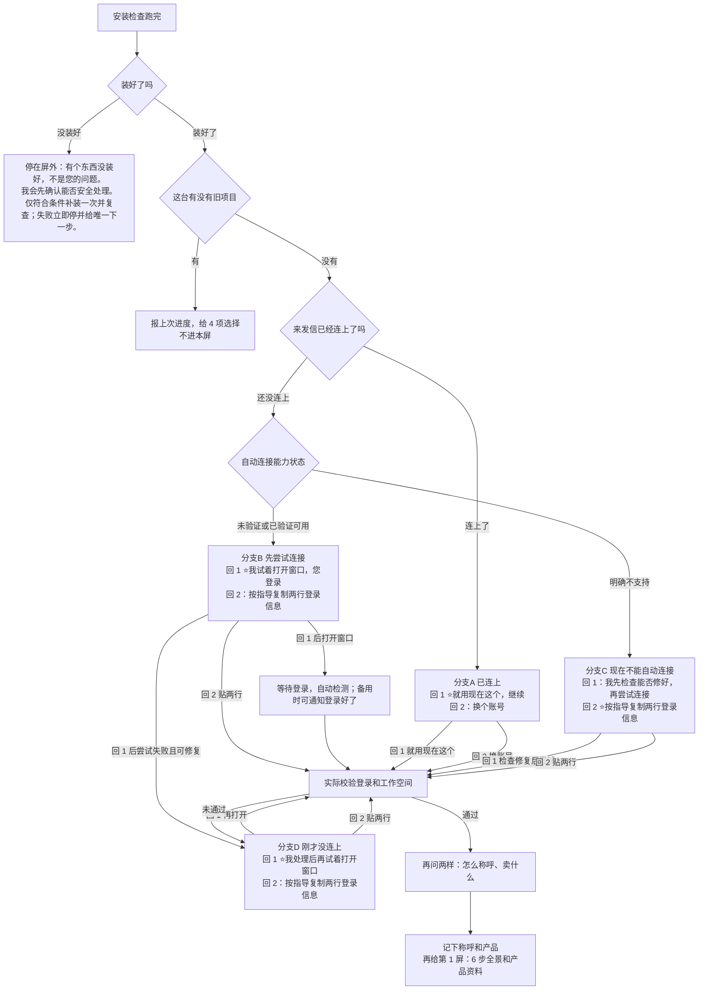

# 新手入口：一页看懂全流程（AI 必读，第一次回复就要按这个开）

> 目标：用户从第一句话就知道 **要做哪些、现在第几步、接下来干嘛**；全程用户只需选编号或回「确认激活」（约 10 次回话），不用记命令、不用看术语。
> 配套：SOP 细节见 `operations-sop.md`；踩坑台账见 `problems-and-fixes-2026-10-23.md`；规则铁律见 `RULES.md（规则总纲）`。

---

## 一、开场两屏（固定格式，AI 必须原样给）

### 第 0 屏 · 刚装好（只做两件事：能帮什么 + 连接来发信）

```text
✅ **装好了**。
- **我能帮您**：找海外买家、写开发信、排跟进
- 现在要连您的来发信账号，只做检查：不找客户、不发信
我查过了：<检测一句>
只是建议，您选一个回复我：
- **回 1** <星或空>：<动作1>
- **回 2** <星或空>：<动作2>
```

> 新用户**先连平台**（连接成功前不问昵称/产品）、**不展示任务菜单**；只有检测到旧项目才按 `output-templates/S0-task-menu.md`「有旧项目时」给 4 项。
> **2026-10-27 二次裁决**：第 0 屏允许**两个数字选项**（回 1 / 回 2），一次只给两个；星标只标推荐的那一行，只推荐、不替用户回。C 的推荐在回 2，其余三支推荐在回 1。旧版「统一让用户自己登录后回『登录好了』」「不要求回数字」已废弃。
> **安装没通过还没到本屏**：自检失败禁止说「装好了」、禁止给回 1 / 回 2。对用户先说：有个东西没装好，不是您的问题。我会先确认能否安全处理。禁止对用户说「组件」。仅白名单依赖缺失且非交互包管理器可用、无需 sudo 或交互时补装一次并复查；无管理器、需 sudo/交互、安装失败或复查失败立即停并给唯一下一步。话术全文见 `output-templates/S0-install-report.md`「安装没通过」。

#### 第 0 屏分流图（判定顺序＝图的箭头方向，AI 按图走，不许跳步）



#### 检测项与判定（只读，出屏前必须跑完）

| # | 检测什么 | 命令（AI 自用） | 判定 |
|---|---|---|---|
| 1 | 装好没有 | `python3 tools/onboard_check.py`（Windows 用 `py`） | 退出码 0 才说「装好了」 |
| 2 | 旧项目 | 同上（扫 `runs/*/`） | 有 → 老用户卡，不进本屏 |
| 3 | 已有登录 | `tools/check_login.py` | 通过 → 分支 A |
| 4 | 能不能自动打开登录 | `python3 tools/browser_login.py --probe-only --browser auto` | `browsers` 非空仅证明发现浏览器；未验证启动、控制或获取登录信息 → B 未验证，明确无法支持 → C；完整能力已验证才可说支持。回 1 前不为验证启动或安装 |
| 5 | 开起来连没连上 | 正式连接返回（浏览器打不开＝错误码 11） | 没连上 → 分支 D；推荐仍是回 1 |

> 分支文案见 `output-templates/S0-install-report.md`「分支对照」表——**那里是唯一文案真源**，本文件只放流程图与判定；两处不一致以卡片为准并改回本图。出屏前完成只读检测；第 5 项仅在用户选择并尝试后判断，命令只留在这张内部表，不进用户屏。
> **连接成功后一次问两样；只答一半时**：缺昵称只补昵称、缺产品只补产品，一句话问完就继续；用户回「1/开始/你好」不算昵称，不得把数字当昵称登记；只发产品照片/链接时先复述产品请用户确认，不要求重发文字。

### 第 1 屏 · 连接成功、拿到昵称和产品后（6 步全景 + 档案直出）

```text
进度：第 1 步 / 共 6 步

好，<昵称>。您说的「<产品>」我记下了（账号刚才已经连好）。整件事分 **6 步**。
发信要您回「**确认激活**」，不说一封都不发。有人回复不会自动停。

① 找买家：先核对产品资料；有目标客户网址，先做样板
② 筛名单：翻到「开始不像买家」的那一页
③ 存客户：先看清存多少，您点头才存
④ 写开发信：先写几封样稿给您看
⑤ 建模板：自动生成 48 个，不是一次发 48 封
⑥ 建跟进计划：12 轮是排好的节奏，不是连发 12 封

**现在这一步**：先发 8 项产品资料，大约 2 分钟。
已有的直接用，查不到写「暂无」，不编。
资料确认后，我问有没有目标客户网址。
是客户的网址，不是您自己的官网。
有就先拿来做样板；没有，平台列出约 4 类给您挑。

从现在起，顺利的话您大约还要回 8 次，最多 9 次：
- 4 次只回数字：选买家、选样板、认可样稿、建跟进计划
- 2 次回一句话：确认产品资料、确认保存；有客户网址时再多发一条
- 1 次可能要贴两行登录信息，只发给我、别发到群里；您已经连上，多半不用
- 最后 1 次说「确认激活」
后面存客户、发信要按用量扣费，动手前我先把数字说清楚。中途改资料或重新连接，会再多一两次。

您现在不用回
该回什么：先不用回——我马上把产品资料发您过目
```

之后**每个阶段级汇报都带三行**：第几步/共几步、正在做什么、等你回什么（不是每句话都贴）。

---

## 二、6 步全景（每步谁干活、用户回什么）

| 步 | 名称 | AI 做什么 | 用户要做什么 | 预计耗时 |
|---|---|---|---|---|
| ① | 🔍 找买家 | 直出产品资料核对 → 问目标客户网址：有则先样板分析，无则平台推演买家类型（默认展示 **4 个**；平台多返回也只对用户列 4 个）→ 您选定类型与样板 | **回编号** 选买家类型；再回编号选样板客户 | 5–7 分钟 |
| ② | 🔍 筛名单 | 自动翻名单，找出「从第几页开始不像买家」 | **不用回**（自动跑并每 10–30 秒报进度）；想停就说一声 | 3–10 分钟 |
| ③ | 📇 存客户 | 保存客户并计数（公司/邮箱/点数） | **卡上写清 N 后回「确认」**（或原话「确认保存 前 N 家」） | 2–10 分钟 |
| ④ | ✉️ 写开发信 | 本地先写 **4 封**样稿（想看更多最多 8 封），可发旧开发信截图作参照 | **回 1** 认可样稿；回 **2** 说改哪封 | 3–8 分钟 |
| ⑤ | 🧩 建模板 | **上一步回 1 后自动**生成 **48 个邮件模板**（12 轮 × 4 种写法）、分组上传并逐封核对，不再单独确认 | 不用回（自动完成） | 5–12 分钟 |
| ⑥ | 🗓 建跟进计划 | 回 1 一次，建计划并把这批客户加进去，还不会发信 | **回 1** 一次：建计划并把这批客户加进去，还不会发信；回 **2** 先别做 | 5–15 分钟 |

> 注：对外只说这 6 步。之后还有第 7 关「🚀 发信开关」——回「**确认激活**」才真发，不计入 6 步。

---

## 三、确认只用数字（不要用户回整句话）

- 能用 1/2/3 的，一律给编号：**1 = 同意/继续（推荐放第一）**，2 = 要改，3 = 先等等/看细节。
- **任何一步提前说「确认激活」**：固定回「还没到发信那一步，发信开关不会开；完成最后设置我再单独问您」，不跳过当前步骤、不提前激活、不催。
- 有两处不是普通数字：**存客户**（要花平台额度）——卡片上会先写清「存多少家 / 大概扣多少额度」，数字不清楚不许让你回；用户可回 **「确认保存 前 N 家」**，也可在卡面已写清 N 时**只回「确认」或精确等于 N 的纯数字**（系统按卡面数量绑定并留痕）；空答无效，1 仅 N=1 时按数量；删除必须带家数，任何纯数字无效；**发信激活**必须回「**确认激活**」四个字（只回「激活」不算），防手滑。
- 每次确认卡片首行和末行都要写清「**该回什么**」。

---

## 四、第 ④ 步：允许发「以前的开发信」截图

AI 写样稿前先查看用户已给的卖点：有则直接复用，不再询问；没有时只问一次「如果有想突出的卖点，可以补充 1–2 条；没有或跳过也可以，我会先用通用的产品或合作范围介绍继续。」不要求数字、参数或认证；不把未经证实的内容写成能力，也不在样稿后以缺卖点卡住 48 个模板。通用介绍不承诺效果或询盘。

AI 在写样稿前，主动说一句（只用一次，不啰嗦）：

> 如果你手上有以前效果好的开发信，**可以截图发我**（1–5 张都行）。我只学它的**结构、语气、开头和结尾方式**，产品事实仍以我们的产品档案为准。

收到截图后 AI 必须做：
1. 提炼「称呼方式 / 开场钩子 / 段落结构 / CTA 写法 / 签名形式」五项，用 3 行话说给用户听；
2. **不得照抄**对方原文里的价格、交期承诺、认证措辞、公司名/电话/邮箱；
3. 事实类内容只从 `product-profile.md` 取，取不到就省略，不许编；
4. 学到的风格写入 `runs/<运营方>/<产品>/email-style.md`（落仓，后续可复用）。写模板前会先过机器闸门（`tools/email_style_gate.py`）：样式文件只允许「称呼/开场/段落/CTA/签名」五项，出现价格、联系方式、认证、承诺等内容会被拒。

---

## 五、哪些资料必须落进 skill 仓库（不许只留在聊天）

| 资料 | 位置 | 为什么要落仓 |
|---|---|---|
| 产品档案 | `runs/<运营方>/<产品>/product-profile.md` | 所有事实的唯一来源 |
| 邮件风格（含用户截图提炼） | `runs/<运营方>/<产品>/email-style.md` | 换会话/换 AI 仍能沿用 |
| 模板计划 + 名称→id 映射 | `template-plan.json`、`template-map.json` | 续跑、补建、核对 |
| 审计证据/复核 | `S4-evidence*.md`、`S4-review*.md`、`audit-manifest.json` | 判定可追溯 |
| 合规核验 | `compliance-check.json` | 激活必备 |
| 运行状态 | `operation-record.md`（status/next_state） | 换机续跑唯一真源 |
| 阶段报告 | `output-templates/S7-template-confirm.md`、`S9-sequence-confirm.md`、`S11-completion-report.md`（话术卡）+ `reflection.md` | 交付可核查 |
| 踩坑台账 | `specs/problems-and-fixes-2026-10-23.md` | 下次不再踩 |

**规则**：凡是「下次 AI 需要知道」的东西，一律写文件；聊天里说过但没落仓 = 不存在。

---

## 六、新手最容易卡住的 8 个点（AI 提前提醒）

1. 别问用户「参数名/字段名/系统术语」——用户不需要懂，直接替用户做决定。
2. 播报别超过 6 行，多了用户不看。
3. 每次只说「现在这一步」，不要一口气讲完全部流程。
4. 长时间任务每 10–30 秒报一次；保存期间使用 `tools/save_company_cli.py status --plan <计划路径> --watch`，每 5–10 秒把工具进度播报给用户。处理数不代表新增数，未知数字不猜；任务结束后仍须对账。GUI 自动推送未实测。
5. 发信时间要换成本机时区，并说「还有多久」。
6. 失败先承认，再给「重试/跳过/改法」三个数字选项。
7. 用户说「随便/你定」时，选推荐项并说明代价，不要空转。
8. 任何写操作前，把「要写什么、影响谁、能不能撤回」用一句话说清。
9. **先报后做**：花时间/花额度的动作（跳页审计、保存、建模板、建序列+加人）先说「范围 / 大概多久 / 最多扣多少点」，用户点头才跑；禁止先跑完再汇报。只读探测（连平台、查余额）可直接做。

---

## 七、AI 自检清单（每次交付前跑一遍）

- [ ] 开场给了 6 步全景 + 当前步 + 接下来 + 只需回什么？
- [ ] 这次有没有用户看不懂的术语（英文缩写、系统术语、内部编号）？
- [ ] 确认是否用了 1/2/3（激活除外）？
- [ ] 写邮件前是否邀请过截图参照（只提一次）？
- [ ] 关键资料是否已落仓（对照第五节表）？
- [ ] 播报是否 ≤6 行、含三要素？
- [ ] 发信时间是否给了三地时区 + 倒计时？

---

## 八、内部口径对照（AI 自用，不对用户说）

用户只看到 6 步 + 最后发信开关；内部状态机 S0-S12 不要念给用户听。

| 用户看到的步 | 对应内部状态 |
|---|---|
| ① 找买家 | S1 连平台 → S0/S0a 产品资料 → S2 客群推演 → S3 选样板客户 |
| ② 筛名单 | S4 审计找边界（逐页抽样、定临界页） |
| ③ 存客户 | S5 保存计划 → S6 保存执行 |
| ④ 写开发信 | S7 本地 4 封样稿（唯一确认点） |
| ⑤ 建模板 | S8 上传 48 个并分组、逐封核对 |
| ⑥ 建跟进计划 | S9 建序列 → S10 加人 → S11 设置核对 |
| 发信开关（第 7 关，不计入 6 步） | S12 激活（必须回「确认激活」四个字） |

**你要回几次**：全程约 **10 次**（自动连接顺利则 9 次）——连接阶段选择方式（自动检测成功无需额外通知）、连接成功后昵称+产品（一次）、产品资料确认（附目标客户网址一问）、选买家类型、选样板客户、确认保存（卡面 N 已知时确认、准确带家数原话或纯数字 N）、认可样稿、建跟进计划（这一次回 1，建计划并把这批客户加进去，不是两次）、最后「确认激活」。其中 **4 次只回数字：选买家、选样板、认可样稿、建跟进计划**；保存可回「确认」、准确带家数原话或精确等于 N 的纯数字，激活要回「确认激活」。建序列和加人已经并进这一次回 1，后文不要再把它们算成不能只回数字的两次。建模板与第 ④ 步**共用同一次确认**（第 ⑤ 步自动执行，不另索回），AI 不得打包授权或代答。

**留痕**：每步结束把状态写进 runs/运营方/产品/operation-record.md 的 status 与 next_state，不对用户展示编号。

## 九、邮件风格文件（可选但推荐）

- 路径：runs/运营方/产品/email-style.md
- 内容：从用户给的旧开发信截图里提炼的五项——称呼方式、开场钩子、段落结构、CTA 写法、签名形式。
- 限制：只学结构与语气；价格、承诺、认证措辞、公司名、电话、邮箱一律不得照抄；事实仍取产品档案。
- 没有截图时该文件可缺省，AI 按产品档案默认风格写。

## 十、验收自检（AI 每轮交付前跑一遍）

- 开场是否给了「6 步 + 当前第几步 + 接下来 + 只需回数字」？
- 本次消息有没有用户看不懂的术语（英文缩写、系统术语、内部编号）？
- 确认是不是 1/2/3（激活除外）？
- 写邮件前是否邀请过一次截图参照？
- 关键资料是否落仓（对照第五节表）？
- 播报是否不超过 6 行、含「正在跑/不用操作/还要多久」？
- 发信时间是否给了三地时区 + 倒计时？
