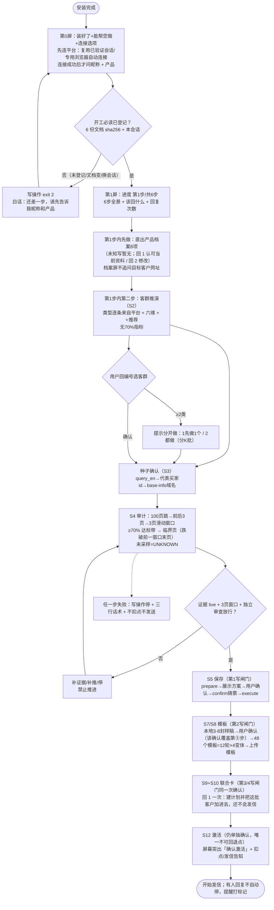
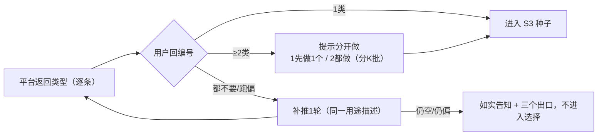
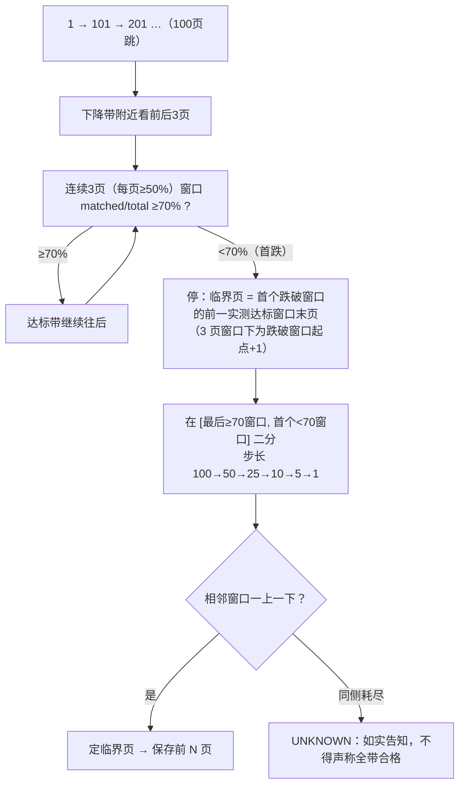
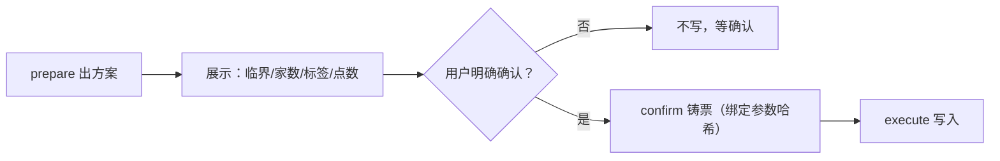

# 🗺️ 新用户全流程·逐模块逻辑（唯一索引）

> **真源优先级**：状态机=S0–S12 编号以 `RULES.md` 为准；临界判据以 `specs/threshold-probe-spec.md` v3.2 为准；本文件=把两者与各模板串成「每步读哪份文档、怎么判、失败去哪、能不能跳」。
> **本文件供 AI 读 Mermaid 源码文本**，不放任何 `output-templates/`（那些是给用户看的屏，禁止出现 Mermaid）。

## 0. 70% 的唯一适用范围（★先看这条）

- **70% 只用于「名单精准度 / 保存边界」**：S4 审计找临界页（连续 3 页（每页≥50%）滑动窗口 ≥70%）、S5 保存范围（前端所有达标页）。
- **客群推演（S2）没有 70% 指标**：S2 的判据是「类型逐条来自平台本次返回 + 六维字段 + ⭐推荐 + 不本地生成」；不得把 70% 套到客群推演上。
- **不是购买概率**：70% 是「这一页 10 条里，属于目标客户线的比例」，判定单位=客户线（直采 / OEM / 拓品 / 非客户）。
- **工具只做趋势初筛**：`audit_company.py` 关键词匹配会误判（漏算船只/海洋/风筝冲浪），正式临界必须 AI 语义反思 + 人工读两两印证。

## 0.1 「跳着找临界点」的完整逻辑（S4）

用户口径原话：**「100 页 1 跳，查看前后 3 页，直到后边低于 70%，然后往回」**。落地流程：

1. **粗跳**：1 → 101 → 201 → … 每 100 页取一个采样点，看整体趋势，定位「高→低」下降带。
2. **前后 3 页**：在下降带附近对每个采样点看前/后 3 页（连续窗口），不要单页定界。
3. **滑动窗口**：唯一判据 = **连续 3 页（每页≥50%）合计 matched/total ≥70%**；单页读数只披露、不定界。
4. **跌破即停 + 往前找**：遇到**首个 <70% 窗口即停**，临界页 = 该窗口**前一窗口的末页**（= 窗口起点 + 3）；**跌破后的反弹窗口一律不得定界**。
5. **窗口二分**：在最后已知 ≥70 窗口 L 与首个 <70 窗口 H 之间二分：步长 100→50→25→10→5→1；同侧耗尽 → 出口 UNKNOWN（不得声称全带合格）。
6. **未采样页 = UNKNOWN**，不得算进达标带；证据里必须记录每页 current / queryId / matched / total / emails 列表。
7. **方向铁律**：一旦跌破只往前找，绝不往后找（后面杂质更多）。
8. **反例保护**：单页非单调（700页80%→710页30%→730页70%），只看单页会误判；必须 3 页窗口 + 两两印证。

## 1. 总览流程图（Mermaid 源码）

## 2. 逐模块逻辑（每节=AI 的执行清单）

### M0 安装完成 / 第0屏
- **读**：`specs/beginner-flow.md`、`output-templates/S0-install-report.md`、`S0-opening-questions.md`、`RULES.md` L18/L89、`specs/novice-flow-contract.md`。
- **动作**：先跑 `onboard_check.py` 自检 → 再跑只读探测（`check_login.py` + `browser_login.py --probe-only`）→ 说「装好了/能帮您做/连接选项 + 一句检测结论」→ **按 A/B/C/D 分支出屏**（分流图见 `specs/beginner-flow.md`「第 0 屏分流图」；失败按 S0-连接未通过 白话有限重试）→ 连接成功后才问昵称+产品。
- **判定**：安装阶段禁止索取市场/卖点/官网/token/邮箱；不展示菜单；**只允许回 1 / 回 2 两个数字选项**；全屏 ≤9 行非空文字、每行 ≤46 字。
- **用户回**：**回 1**（推荐路径的下一步）或 **回 2**（手动办法/换账号）；连接成功后昵称 + 一句话产品（一次回两样）。
- **可跳**：❌ 不可跳；**跳了怎么回填**：无回填，必须补问。

### M0.5 连接平台（第一业务动作，用户只在专用浏览器里登录一次）
- **读**：`output-templates/T-token-guide.md`、`tools/browser_login.py`、`tools/check_login.py`。
- **动作**：优先复用已验证会话，否则专用浏览器自动连接；人工两值仅环境故障兜底。
- **判定**：check_login + workspace_guard 通过才继续；仅检测到浏览器不证明自动连接能力。用户未答不当同意，自动检测成功无需再回复；备用通知后仍须实际校验登录和空间。失败按 S0-连接未通过 三行话术，不让用户排查；连接成功前不问昵称/产品。

### M1 开工门登记（连接成功、收齐昵称+产品后；用户看不见）
- **读**：`AGENTS.md`、`tools/startup_gate.py`。
- **动作**：`python3 tools/startup_gate.py ack --nickname <昵称> --product <产品>`。
- **判定**：6 份必读 sha256 未变 + 本会话；文档变 → 重新 ack；换会话 → 重新 ack；账本符号链接 → 拒绝。
- **失败**：任何写操作 exit 2 + 白话「还差一步：先告诉我昵称和产品」；不把文件名/命令给用户。
- **可跳**：❌ 不可跳（16 个写脚本 + 保存链全接门）。

### M2 第1屏：6步全景
- **读**：`specs/beginner-flow.md` 第1屏、`specs/novice-flow-contract.md`。
- **动作**：首行「进度：第 1 步 / 共 6 步」→ 6 步全景 → 现在做什么 → 回复次数口径（总 10 次；自动连接顺利 9 次；第 1 屏只说「还要回 7 次」）→ 该回什么。
- **判定**：之后每个**阶段级**汇报都带三行（进度/现在/该回什么）；播报 10–30 秒一次。
- **可跳**：❌ 不可跳（用户必须知道全景）。

### M3 连接补充（第0屏，产品资料之前）
- **读**：`output-templates/T-token-guide.md`、`S0-connect-success.md`、`S0-connect-failed.md`、`RULES.md` 凭据三层降级。
- **动作**：CDP 自动取参（首选）→ 一键命令兜底 → 手动两值兜底；首次平台调用前 `check_login.py` + `workspace_guard`。
- **判定**：token/orgId 缺一不可；orgId 错 → 连错空间，工具裁决；未连通禁止任何查询/写。
- **失败**：按 `S0-connect-failed.md` 三行话术；不许让用户自己排查；不许索要 token 明文。
- **可跳**：❌ 不可跳（跳=后面全部无效）。

### M4 产品档案（S0a，连接成功后）
- **读**：`output-templates/S0-product-profile.md`、`specs/product-profile-sop.md`、`S0a-website-profile.md`、`specs/website-profile-sop.md`。
- **动作**：8 项档案卡给用户核对（③核心卖点 ⑤规格认证 ⑧可引用数字 必须用户确认）→ 用户回 1 次。
- **判定**：无来源/行业推断的具体事实禁止写进邮件正文；签名区只有个人昵称。
- **可跳**：⚠️ **官网增强可跳**（只影响本地档案，不影响主线）；**8 项核对不可跳**。

### M5 客群推演（S2）★无 70% 指标
- **读**：`output-templates/S2-segment-confirm.md`、`specs/product-fit.md`、`specs/marketing-rules-2.0.md`、`methodology/decision-trees.md`。
- **动作**：平台返回的买家类型**逐条展示**（默认 4 类，可扩到 8）→ 每类给周期/询盘速度/量级/邮箱/竞争度/⭐推荐 → 用户只回编号。
- **判定**：类型只能来自平台本次返回；不得本地生成 A/B/C/D 字母清单；不得映射成标签；缺口数据标「未返回」。
- **多类**：≥2 类必须提示「分开做」（模板/序列翻倍），给「1 先做 1 个 / 2 都做（分 K 批）」编号选项。
- **可跳**：❌ 不可跳；但**可换**（推翻重推，最多补推 1 轮）。
- **Mermaid 源码**：

### M6 种子确认（S3）
- **读**：`output-templates/S3-seed-confirm.md`、`RULES.md` S3 行、`specs/data-structure.md`。
- **动作**：明确询问「有没有目标客户网址（客户、非自己官网）」；有则以该客户为起点，没有/跳过则平台候选推演；已给过不再重问。`query_en` 搜第一页（含 id）→ 代表买家 id → `base-info` 取真实域名 → 域名作 keyword 扩量（禁 similar-list）。
- **判定**：确认是「客户方非自己/非 4 区/产品相关」；用户确认锚点后才进 S4。
- **可跳**：❌ 不可跳（无种子=无法审计）。

### M7 审计与临界（S4）★70% 唯一出处
- **读**：`specs/threshold-method.md`（方法论 v2）、`specs/threshold-probe-spec.md`（v3.2 执行细则，冲突以此为准）、`output-templates/S4-audit-running.md`、`tools/audit_company.py`、`tools/finalize_audit.py`。
- **动作**：100 页跳 → 前后 3 页 → 连续 3 页（每页≥50%）滑动窗口 → 跌破即停往前 → 窗口二分 → 临界页。
- **判定**：唯一判据=3 页窗口 ≥70%；单页只披露；未采样=UNKNOWN；**不得用 High 比例/搜索分数/页1·2·5抽样替代窗口证据**。
- **失败**：证据非 live / 有模拟标记 / 审查未放行 → 禁止推进 S4→S5。
- **可跳**：❌ 不可跳（跳=保存范围无依据）。
- **Mermaid 源码**：

### M8 保存客户（S5 计划 → S6 执行，第1写闸门）
- **读**：`output-templates/S5-save-confirm.md`、`RULES.md` 审批硬闸门、`tools/save_company_cli.py`。
- **动作**：`prepare` → 展示保存方案（临界页/N/标签/排除4区/预估点数）→ 用户确认 → `confirm` 铸票 → `execute`。
- **判定**：唯一真实保存通道；无 confirmed plan/render/ticket 不写；卡面 N 已知时用户可回「确认」、准确带家数原话或精确等于 N 的纯数字；空答无效，1 仅 N=1 时按数量。删除必须带家数，任何纯数字无效。
- **可跳**：❌ 严禁跳（机器强制：执行卡+开工门+票据）。
- **Mermaid 源码**：

### M9 模板（S7/S8，第2写闸门）★一次确认在第 4 步，第 5 步自动
- **读**：`output-templates/S6-count-report.md`、`S7-template-confirm.md`、`specs/sequence-config.md`、`tests/test_subject_per_variant.py`（主题规则测试）。
- **动作**：先本地写 **3–8 封样稿**（跨轮代表）→ 用户确认 → 批量套成 **48 个模板 = 12 轮 × 4 种写法** → 分组命名 → 建模板 → 校验（模板列表/数量/diff）。
- **判定**：每封主题不同、正文不同；标题不插变量；正文事实只来自用户确认过的 product-profile 字段；签名区只有昵称；CTA 必须突出。
- **顺序铁律**：**S6 数量账与 S7 模板确认合成一次确认**（用户确认样稿即代表数量与模板一起确认），不要拆成两个来回。
- **可跳**：❌ 不可跳（未确认样稿不得批量建 48 个模板）。

### M10+M11 序列+加人（S9+S10 联合卡，第3/4写闸门合并确认）
- **联合确认（A方案,用户已授权）**：一次回复确认建序列+加人，走 `tools/sequence_contact_bundle.py`（present 出卡→confirm 引用卡→execute）；两动作分别参数绑定/审批/票据，加人失败保持部分完成先回读核对；激活仍是第5写闸门。

### M10 序列（S9，第3写闸门）
- **读**：`output-templates/S8-template-building.md`、`S9-sequence-confirm.md`、`specs/sequence-config.md`。
- **动作**：同一张卡展示 12 步跟进计划（间隔/内容/给谁）和本批加人 → 用户回 1 一次，同时确认建计划并把这批客户加进去（还不会发信）→ 建序列 → 校验（步骤数/模板绑定）。
- **判定**：序列步骤数=12，模板绑定正确；未确认不得建。
- **可跳**：❌ 不可跳。

### M11 加联系人（S10，第4写闸门）+ 激活（S12，第5写闸门）
> 真实 API/参数/门禁见 `specs/module-api-map.md` M11/M12（现役加人脚本 = `contact_add_authorized.py`）。
- **读**：`output-templates/S10-contacts-confirm.md`、`S11-completion-report.md`、`S12-activation-confirm.md`、`RULES.md` 激活原话规则。
- **动作**：加人与建计划在同一张卡、同一次回 1 里确认（名额/去重/预算写在这张卡上，不再另要一次回复）→ 加人；激活前展示「会开始发信、可能扣点」→ 用户回**含「确认激活」四字**的原话 → 激活。
- **判定**：保存、这次联合确认、激活仍各自确认、不代答；建序列和加人并进这一次回 1，不再各算一次；激活是唯一不可回退点。
- **可跳**：❌ 不可跳；加人可**缩量**（用户选小样），但不可跳过确认。

### M12 出错 / 停下 / 续接
- **读**：`output-templates/S0-connect-failed.md`、`specs/problems-and-fixes-2026-10-23.md`、`wiki/faq.md`、`lessons/lessons-learned.md`、`methodology/decision-trees.md`。
- **三段式**：①一句话结论+跟您账号无关 ②您现在要做的唯一一件事（或“什么都不用做，等我”）③本次没动数据。
- **续接**：`.local/operation-record` + `approvals.tsv` + `gate/startup.jsonl`；换机/换会话需重新 ack；旧审批只作历史。
- **可跳**：出错不可跳；续接可跳回当前节点（不回 S0），但必须重新 ack。

## 3. 跳步规则总表

| 步骤 | 可跳？ | 跳了怎么回填 |
|---|---|---|
| 安装自检 / 第0屏问两样 | ❌ | — |
| 开工门 ack | ❌ | — |
| 第1屏 6步全景 | ❌ | — |
| 连平台 | ❌ | — |
| 官网增强 | ✅ 可跳 | 跳过即用现有档案，不阻塞；之后可补 |
| 产品档案 8 项核对 | ❌ | — |
| 客群推演 | ❌ 可换不可跳 | 推翻重推最多 1 轮，需记录原因 |
| 种子确认 | ❌ | — |
| S4 审计/临界 | ❌ | 未采样标 UNKNOWN，不得跳着宣称合格 |
| S5 保存 | ❌ 机器强制 | — |
| S7/S8 模板（样稿→48） | ❌ | — |
| S9 序列 | ❌ | — |
| S10 加人 | ❌ 可缩量不可跳 | 缩量需用户明确选择并进同一 plan |
| S12 激活 | ❌ 唯一不可回退 | 必须含「确认激活」原话 |

## 4. 步骤 → 文档索引

| 模块 | 必读文档 | 模板屏 |
|---|---|---|
| M0 安装/第0屏 | beginner-flow、novice-flow-contract、RULES L18/L89 | S0-安装完成汇报、S0-开场提问 |
| M1 开工门 | AGENTS、tools/startup_gate.py | — |
| M2 第1屏 | beginner-flow、novice-flow-contract | — |
| M3 连平台 | RULES 凭据三层、check_login/workspace_guard | T-token引导、S0-连接成功/未通过 |
| M4 产品档案 | product-profile-sop、website-profile-sop | S0-产品知识档案、S0a-网站资料确认 |
| M5 客群 | product-fit、marketing-rules-2.0、decision-trees | S2-客群确认 |
| M6 种子 | RULES S3、data-structure | S3-种子确认 |
| M7 审计/临界 | threshold-method、threshold-probe-spec、audit_company/finalize_audit | S4-审计进行中 |
| M8 保存 | RULES 审批闸门、save_company_cli | S5-保存确认 |
| M9 模板 | sequence-config、subject 测试 | S6-数量账、S7-模板确认 |
| M10 序列 | sequence-config | S8-模板构建中、S9-序列确认 |
| M11 加人/激活 | RULES 激活原话 | S10-加联系人确认、S11-完成汇报、S12-激活确认 |
| M12 出错/续接 | problems-and-fixes、wiki/faq、lessons、decision-trees | S0-连接未通过 |

## 5. 修订记录

- **2026-10-23**：新建本文件；统一「100 页跳 + 前后 3 页 + 3 页滑动窗口 + 跌破往前 + 窗口二分」为 S4 唯一流程；明确 70% 不适用于客群推演；把 S6/S7 合成一次确认；补全 12 模块的输入/动作/判定/失败/可跳。
- 待同步：`RULES.md` 与 `INDEX.md` 中仍写「50 页跳」的两处，本文件与 threshold-probe-spec v3.2 均按 **100 页跳** 执行。
